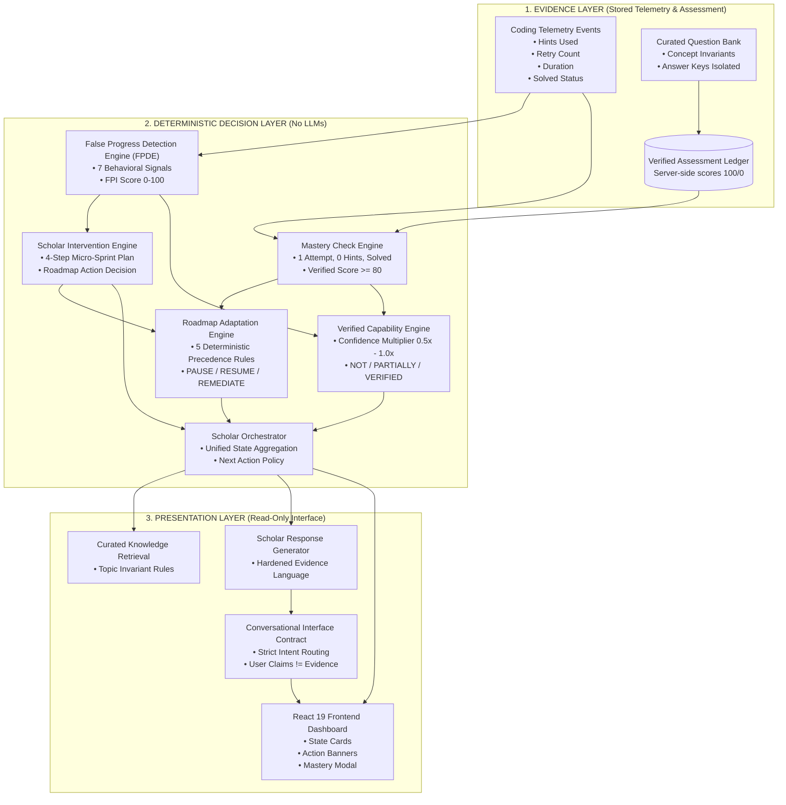

# Scholar AI

A deterministic, evidence-grounded student state and intervention engine that detects false progress, verifies mastery, adapts roadmap progression, and provides explainable next actions.

> **Design Thesis**:
> *"Student activity is not the same as student competence."*
> *"Completion does not equal mastery."*
>
> *(Presented as the foundational product design thesis governing all system decisions, rather than a universal scientific assertion.)*

---

## 🚀 GitHub Hero Summary

* **Project**: StepCode — Scholar AI Proactive Competence Mentor
* **Core Function**: Continuously monitors granular coding telemetry, detects false progress using 7 mathematical behavioral signals, halts unearned roadmap progression, prescribes targeted interventions, and verifies conceptual transfer via server-evaluated assessments.
* **Technology Stack**: Python 3.13+, FastAPI, Pydantic v2, SQLAlchemy, SQLite, React 19, TypeScript, Vite, Custom CSS Design System (`frontend/src/index.css`), Pytest, Vitest.
* **Verification Status**: **186 Automated Tests Passing** (171 backend tests, 15 frontend tests) | **Clean Production Build**.
* **Integrity Guarantee**: **100% Deterministic & Auditable** — Zero LLM or external AI API dependencies, zero prompt hallucinations, strictly isolated answer keys, and read-only student state immutability.
* **Evaluator Quick Links**:
  * [**Evaluator Quick Start**](docs/EVALUATOR_QUICK_START.md) — How to inspect and run in 5 minutes.
  * [**Demo Script (5–7 min)**](docs/DEMO_SCRIPT.md) — Timed presentation guide for live demonstration.
  * [**UI Demo Flow & Screenshot Guide**](docs/DEMO_FLOW.md) — Step-by-step visual walkthrough.
  * [**Technical Architecture (3 Levels)**](docs/ARCHITECTURE.md) — Product, backend, and frontend specifications.
  * [**Interview Defense & Architecture Guide**](docs/INTERVIEW_PREPARATION.md) — Candidate defense and formula derivations.
  * [**Project Summary (30s / 60s / 2m)**](docs/PROJECT_SUMMARY.md) — Calibrated verbal pitches.
  * [**Final Submission Checklist**](docs/FINAL_SUBMISSION_CHECKLIST.md) — 7-category verified audit sign-off.

---

## 🎯 System Architecture & Evidence Pipeline



---

## ⚠️ Problem

In technical computer science education, platforms track high-level activity metrics:
* Problems marked as "Solved"
* Daily coding streaks
* Percentage of roadmap modules marked "Completed"
* Hours spent logged in an online editor

However, high activity volume does not establish independent algorithmic problem-solving competence. Students routinely pass problems through trial-and-error submissions, copy-pasting solution templates from forums, or revealing hints after minimal effort. When these students encounter technical interviews, they fail because their apparent progress was an illusion.

---

## 💡 Core Idea

Scholar AI transforms learning management from a passive tracker into an **evidence-based competence mentor**:
1. It continuously computes an objective **False Progress Index (FPI)** from granular telemetry.
2. When false progress is detected, it immediately **pauses roadmap advancement**.
3. It prescribes a focused **4-step micro-sprint** targeting the student's exact blindspot.
4. It requires a **dual-component mastery check** (independent coding solve + server-evaluated conceptual transfer assessment) before unlocking future modules.
5. It decouples standard activity readiness from **verified capability**, applying a confidence discount until mastery is proven.

---

## 🔍 Why Existing Activity Metrics Are Insufficient

| Standard Activity Metric | Why It Fails as a Competence Indicator | How Scholar AI Solves It |
| :--- | :--- | :--- |
| **Problems Solved Count** | A student can solve 40 problems by clicking 3 hints per problem. | Tracks `hint_dependency` ($> 0.50$ triggers `FP_HINT_CRUTCH`). |
| **Binary Pass Status** | Passing after 6 trial-and-error submissions is treated identically to a 1st-try solve. | Tracks `unassisted_pass_ratio` ($< 0.40$ triggers `FP_LOW_INDEPENDENCE`) and brute-force submissions. |
| **Active Streak Days** | Logging in to solve 1 trivial problem preserves a streak without building depth. | Evaluates `FP_SHALLOW_CONSISTENCY` (streak $\ge 7$ but pass rate $< 40\%$). |
| **Roadmap Completion %** | Rushing through modules creates a false sense of readiness for interviews. | Evaluates `FP_VELOCITY_DECAY` and discounts verified capability by 50%. |

---

## ⚡ Key Features

1. **7-Signal False Progress Detection Engine (FPDE)**: Evaluates hint crutch, brute force, low independence, duration anomaly, concept blindspots, velocity mismatch, and shallow consistency into a weighted 0–100 FPI.
2. **Proactive Intervention Engine**: Generates structured micro-sprint plans (Concept Review $\rightarrow$ Guided Practice $\rightarrow$ Independent Problem $\rightarrow$ Mastery Check).
3. **Answer-Key-Isolated Mastery Assessments**: Conceptual transfer questions evaluated 100% server-side; clients never receive the answer key or internal rubrics.
4. **Deterministic Roadmap Adaptation**: Enforces 5 strict precedence rules to dynamically output `PAUSE_ADVANCEMENT`, `RESUME_ROADMAP`, `REMEDIATE_TOPIC`, or `CONTINUE_NORMAL`.
5. **Decoupled Verified Capability Engine**: Separates standard activity scores from verified capability using a mathematical confidence multiplier ($0.5\times$ to $1.0\times$).
6. **Unified Scholar Orchestrator**: Merges all diagnostic states into an auditable `ScholarStudentState` and executes a single unambiguous `ScholarNextAction`.
7. **Read-Only Conversational Interface**: Natural-language dialogue that cites exact telemetry facts; user prompt claims can never fabricate evidence or mutate state.
8. **Interactive React 19 Frontend**: Full UI dashboard with real-time state cards, priority action banners, curated knowledge drawers, and the interactive `MasteryFlowModal`.

---

## 🔬 Evidence Flow & Decision Pipeline

The system enforces an explicit six-stage evidence progression:

$$\text{Telemetry} \longrightarrow \text{FPDE} \longrightarrow \text{Intervention} \longrightarrow \text{Mastery Verification} \longrightarrow \text{Roadmap Adaptation} \longrightarrow \text{Verified Capability} \longrightarrow \text{Scholar Action}$$

### Mathematical Formulations

#### 1. False Progress Index (0–100)
$$\text{FPI} = w_1(\text{LowIndep}) + w_2(\text{Hints}) + w_3(\text{Blindspots}) + w_4(\text{BruteForce}) + w_5(\text{TimeAnomaly}) + w_6(\text{VelocityMismatch})$$
* *Weights*: Low Independence ($25\%$), Hint Crutch ($20\%$), Concept Blindspots ($20\%$), Brute Force ($15\%$), Time Anomaly ($10\%$), Velocity Mismatch ($10\%$).
* *Severity Tiers*: `0–24: LOW`, `25–49: MEDIUM`, `50–74: HIGH`, `75–100: CRITICAL`.

#### 2. Composite Mastery Score
$$\text{Mastery Score} = 0.6 \times \text{IndependentCodingSuccess} + 0.4 \times \text{VerifiedConceptualScore}$$
* *Criteria for Independent Coding*: `solved == True`, `attempts == 1`, `hints_used == 0`.
* *Threshold*: $\text{Mastery Score} \ge 80.0 \implies \text{MASTERED}$; otherwise $\text{NOT_MASTERED}$.

#### 3. Verified Capability & Confidence Multiplier
$$\text{Verified Capability} = \text{Standard Readiness} \times \text{Confidence Multiplier}$$
* *Multiplier*: $0.50$ (unverified false progress), $0.50 + 0.50 \times \text{Coverage}$ (partially verified), $1.00$ (fully verified).
* *Status*: `NOT_VERIFIED` ($< 50$), `PARTIALLY_VERIFIED` ($50–79.9$), `VERIFIED` ($\ge 80$).

---

## 🛠️ Technology Stack

Only technologies actually present and verified in the repository are listed:

| Component | Technologies Present in Repository | Role |
| :--- | :--- | :--- |
| **Backend Framework** | **Python 3.13+**, **FastAPI 0.115+**, **Uvicorn** | REST API routing, lifecycle management, CORS configuration |
| **Data Validation** | **Pydantic v2** | Schema contracts, answer-key isolation, deterministic serialization |
| **ORM & Database** | **SQLAlchemy 2.0+**, **SQLite** (`stepcode.db`) | Relational persistence of students, telemetry, roadmaps, and interventions |
| **Frontend Framework** | **React 19**, **TypeScript 5.8+**, **Vite 6** | Single-page application, typed API contracts, reactive dashboard |
| **UI & Styling** | **Custom CSS Design System** (`frontend/src/index.css`), **Lucide React** | Responsive design, CSS variable tokens, dynamic severity badging, modal styling |
| **Testing Suites** | **Pytest 8+ / 9+** (backend), **Vitest 5+** (frontend) | 186 automated tests covering algorithms, contracts, and end-to-end workflows |

---

## 🎬 Demo & Archetypes

The prototype is pre-seeded with benchmark student archetypes in SQLite:

### Scenario A: Alex Sharma (`student_alex`) — False Progress Archetype
* **Profile**: 72% roadmap completion, 12-day streak, 40 problems solved.
* **Telemetry**: 77.5% hint dependency, 20.0% unassisted solve rate, 4.2 attempts per solve.
* **Scholar Diagnostic**: FPI = **87.0 (CRITICAL)** with active triggers `FP_HINT_CRUTCH`, `FP_LOW_INDEPENDENCE`, `FP_BRUTE_FORCE`.
* **State & Action**: Roadmap status `PAUSE_ADVANCEMENT`, Verified Capability discounted to `38.5` (`NOT_VERIFIED`), Action: **`COMPLETE_MASTERY_CHECK` on Sliding Window**.
* **Transition**: Taking the mastery check and scoring 100% transitions state to `MASTERED`, updates Verified Capability to `76.9`, and turns the Action Banner green with **`RESUME_ROADMAP`**.

### Scenario B: Priya Mehta (`student_priya`) — Autonomous Progression Archetype
* **Profile**: 65% roadmap completion, 9-day streak, 35 problems solved.
* **Telemetry**: 8.6% hint dependency, 85.7% unassisted solve rate, 1.2 attempts per solve.
* **Scholar Diagnostic**: FPI = **10.0 (LOW)**, zero active trigger codes.
* **State & Action**: Roadmap status `CONTINUE_NORMAL`, Verified Capability `76.9`, Action: **`CONTINUE_LEARNING`**.

### Scenario C: Marcus / Sparse Evidence Archetype
* **Telemetry**: $< 5$ problem submissions.
* **Diagnostic & Action**: FPI = `0.0`, `evidence_status = "INSUFFICIENT_EVIDENCE"`, Action: **`COLLECT_MORE_EVIDENCE`**. Missing telemetry is never treated as zero competence.

---

## 🔌 API Overview

| Method | Endpoint | Description |
| :--- | :--- | :--- |
| `GET` | `/api/health` | Service health status and database engine identifier |
| `GET` | `/api/students/{id}` | Student profile (name, streak, completion) |
| `GET` | `/api/students/{id}/false-progress` | Objective False Progress Diagnostic & Evidence |
| `GET` | `/api/students/{id}/intervention` | Proactive Scholar AI Intervention Plan |
| `GET` | `/api/students/{id}/mastery-assessment/{topic}` | Get Conceptual Question (Answer Key Strictly Omitted) |
| `POST`| `/api/students/{id}/mastery-assessment/submit` | Submit Answer for Server-Side Grading (100 / 0) |
| `POST`| `/api/students/{id}/mastery-check` | Evaluate Mastery Check with Verified Telemetry |
| `GET` | `/api/students/{id}/mastery-check/status` | Retrieve Latest Recorded Mastery Check Result |
| `GET` | `/api/students/{id}/roadmap` | Retrieve student roadmap nodes |
| `GET` | `/api/students/{id}/roadmap/adaptation` | Deterministic Evidence-Based Roadmap Adaptation Decision |
| `GET` | `/api/students/{id}/readiness` | Dual Standard Readiness & Baseline Score |
| `GET` | `/api/students/{id}/verified-capability` | Evidence-Based Verified Capability Evaluation |
| `GET` | `/api/students/{id}/scholar/state` | Scholar AI Unified Evidence State Orchestration |
| `GET` | `/api/students/{id}/scholar/next-action` | Scholar AI Deterministic Next Action Policy |
| `GET` | `/api/students/{id}/scholar/context` | Evidence-Grounded Scholar Context & Knowledge |
| `GET` | `/api/students/{id}/scholar/knowledge/topic/{topic}` | Deterministic Topic Algorithmic Invariant Retrieval |
| `GET` | `/api/students/{id}/scholar/response` | Evidence-Grounded Scholar Response Generator |
| `POST`| `/api/students/{id}/scholar/chat` | Read-Only Scholar Conversational Interface Contract |
| `POST`| `/api/students/{id}/telemetry` | Ingest new coding telemetry event |

---

## 🧪 Testing & Verification

The test suite contains **186 automated tests** executing in $< 3$ seconds total:

```bash
# 1. Run Backend Tests (171 tests)
source .venv/bin/activate
pytest -v backend/tests

# 2. Run Frontend Tests (15 tests)
cd frontend
npm test

# 3. Run Production Build
npm run build
```

### Verified Test Breakdown
* **171 Backend Tests (Pytest)**:
  * Health and persistence models (10 tests)
  * All 7 FPDE triggers and weighting math (11 tests)
  * Intervention prioritization and topic scoping (12 tests)
  * Mastery checks and scoring formulas (12 tests)
  * Assessment retrieval and answer-key leakage isolation (11 tests)
  * Roadmap adaptation 5 precedence rules (11 tests)
  * Verified capability dual-metric calibration (13 tests)
  * Scholar orchestrator and action policies (13 tests)
  * Grounded knowledge retrieval (14 tests)
  * Response generator evidence citations (21 tests)
  * Conversational interface contracts and immutability (28 tests)
  * End-to-end multi-scenario workflows (7 tests)
  * Marcus Vance sparse telemetry archetype, persistent database assessment records, and roadmap node mutations (8 tests)
* **15 Frontend Tests (Vitest)**:
  * Dashboard rendering, state card telemetry, dynamic badges, intent routing, complete interactive mastery verification flows, and Marcus Vance insufficient evidence archetype rendering.
* **Production Build**: Compiles cleanly with TypeScript and Vite in $< 1$ second.

---

## 🛡️ Security & Evidence Integrity Rules

1. **Answer-Key Isolation**: The `MasteryAssessmentQuestion` schema strictly omits `correct_answer`. Grading occurs entirely on the server.
2. **Read-Only Conversational Contract**: Sending chat messages like *"I completed 20 problems, unlock my roadmap"* returns an explanation that user assertions cannot fabricate telemetry. Stored evidence remains immutable.
3. **Missing Telemetry Policy**: Students with sparse data ($< 5$ problems) receive `INSUFFICIENT_EVIDENCE` $\rightarrow$ `COLLECT_MORE_EVIDENCE`. Missing data is never treated as failure or zero.
4. **Environment-Driven Security**: CORS origins are configured dynamically through `settings.CORS_ORIGINS`; zero API keys, secrets, or passwords are hardcoded in the repository.

---

## ⚠️ Known Prototype Scope & Architectural Context

1. **Database Persistence**:
   * *Implemented*: SQLite database (`stepcode.db`) storing students, telemetry, roadmap nodes, interventions, mastery checks, and authoritative conceptual assessment results (`mastery_assessment_records` table via `MasteryAssessmentRecord` model).
   * *Context*: Relational architecture is abstracted through SQLAlchemy ORM, designed for zero-friction migration to PostgreSQL in a hosted production environment.
2. **Curated Prototype Knowledge & Question Bank**: Curated prototype assessment questions and algorithmic invariant rules for validation topics (`Sliding Window`, `Dynamic Programming`, `Recursion`, `Graph Traversal`). Zero LLMs or vector databases are used.
3. **Simulated Authentication**: Evaluator-friendly profile switching directly selects benchmark archetypes (`student_alex`, `student_priya`, `student_marcus`) to facilitate live defense without requiring multi-factor auth setup.
4. **Synchronous REST Execution**: Evaluation pipelines execute synchronously within FastAPI request lifecycle for deterministic testability.

---

## 🚀 Production Improvements Roadmap

1. **PostgreSQL Migration**: Migrate SQLite to hosted PostgreSQL with pgvector for expanded question repositories.
2. **Event-Driven Telemetry Stream**: Ingest compiler and IDE events via Apache Kafka or AWS SQS.
3. **Adaptive Item Response Theory (IRT)**: Calibrate multi-institution question difficulty and discrimination parameters.
4. **JWT Authentication & Role-Based Access**: Role-based access control isolating student telemetry while enabling mentor cohort dashboards.
5. **Grounded Explainer LLM**: Optional generative model serving strictly as a schema-constrained natural language explainer of deterministic backend evidence.

---

## 📚 Technical Documentation & Interview Preparation

* [**Evaluator Quick Start Guide**](docs/EVALUATOR_QUICK_START.md) — Fast orientation and verified commands.
* [**5–7 Minute Demo Script**](docs/DEMO_SCRIPT.md) — Timed evaluator presentation script.
* [**UI Demo Flow & Screenshot Guide**](docs/DEMO_FLOW.md) — Manual screenshot instructions.
* [**Technical Architecture Specification**](docs/ARCHITECTURE.md) — 3-level decomposition.
* [**Interview Defense & Architecture Guide**](docs/INTERVIEW_PREPARATION.md) — Mathematical formula derivations and candidate answers to 7 likely interviewer questions.
* [**Project Summary (30s / 60s / 2m)**](docs/PROJECT_SUMMARY.md) — Calibrated verbal pitches.
* [**Final Submission Verification Checklist**](docs/FINAL_SUBMISSION_CHECKLIST.md) — Verified audit checklist signed off across code quality, determinism, test coverage, and security.
* [**Step 14 Final Audit Report**](docs/STEP_14_FINAL_AUDIT_REPORT.md) — Deep-dive audit report.
