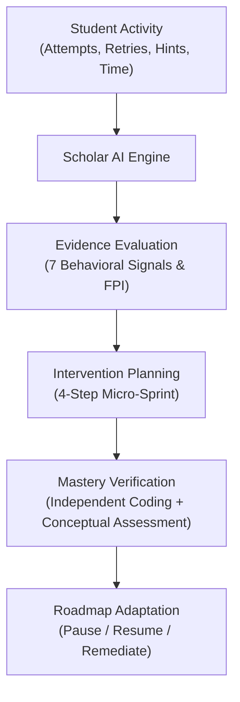
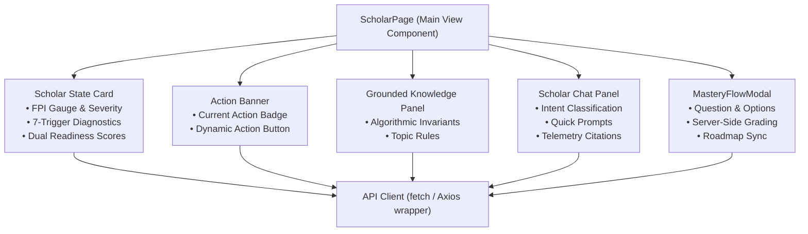

# Scholar AI — System Architecture Specification

This document provides a three-level architectural decomposition of the Scholar AI prototype, detailing how product objectives map to backend service pipelines and frontend interface components.

---

## Level 1 — Product Architecture

At the product level, Scholar AI functions as a **proactive competence mentor** that continuously monitors student problem-solving behavior, safeguards learning integrity, and regulates roadmap advancement.

### 1. Student Activity
The student writes and submits code within an interactive environment. Rather than recording only a binary pass/fail bit, the system captures rich granular telemetry: retry counts, hint requests, coding duration, and first-attempt outcomes.

### 2. Scholar AI Engine
The core intelligence evaluates whether student progress represents authentic understanding or surface-level false progress.

### 3. Evidence Evaluation
Telemetry is processed through 7 deterministic behavioral triggers to calculate the **False Progress Index (FPI)**.

### 4. Intervention Planning
If high false progress is detected, Scholar AI generates a focused 4-step micro-sprint targeting the specific conceptual blindspot (e.g., Sliding Window, Dynamic Programming).

### 5. Mastery Verification
The student must demonstrate competence through an independent coding attempt paired with a server-evaluated conceptual transfer assessment.

### 6. Roadmap Adaptation
Based on verified mastery outcomes, the engine dynamically adapts the roadmap: pausing advancement during struggle, inserting remediation nodes on failure, or unlocking forward progression upon verified mastery.

---

## Level 2 — Backend Architecture

The backend is built with **FastAPI**, **Pydantic v2**, and **SQLAlchemy** on **Python 3**, adhering to a clean layered architecture:

```mermaid
flowchart LR
    subgraph Presentation ["Routers Layer"]
        R1["scholar_router\n(/api/students/{id}/scholar/*)"]
        R2["dashboard_router\n(/api/students/{id}/*)"]
        R3["telemetry_router\n(/api/students/{id}/telemetry)"]
    end

    subgraph Validation ["Schemas Layer"]
        S1["ScholarStudentState\nScholarNextAction"]
        S2["MasteryCheckRequest\nMasteryCheckResult"]
        S3["AssessmentQuestion\nSubmissionPayload"]
    end

    subgraph CoreDomain ["Services Layer"]
        FPDE["FalseProgressDetector"]
        INT["InterventionService"]
        MS["MasteryService"]
        MAS["MasteryAssessmentService"]
        RMA["RoadmapAdaptationEngine"]
        RS["ReadinessService"]
        ORCH["ScholarOrchestratorService"]
        KNOW["ScholarKnowledgeService"]
        RESP["ScholarResponseService"]
        CONV["ScholarConversationService"]
    end

    subgraph Persistence ["Evidence & Database"]
        DB[("SQLite Database\n(Student, Problem, Telemetry, Roadmap)")]
        LEDGER[("Verified Assessment Records\n(mastery_assessment_records table)")]
        KB[("Curated Knowledge Bank\nprototype_knowledge")]
    end

    Presentation --> Validation
    Validation --> CoreDomain
    CoreDomain --> Persistence
```

### 1. Routers Layer (`backend/app/routers/`)
* **`scholar.py`**: Exposes `/api/students/{id}/scholar/state`, `/next-action`, `/context`, `/response`, `/chat`, and `/mastery-check`.
* **`dashboard.py`**: Exposes `/api/students/{id}`, `/false-progress`, `/intervention`, `/mastery-assessment/{topic}`, and `/verified-capability`.
* **`telemetry.py`**: Exposes `/api/students/{id}/telemetry` for ingesting coding events.
* **`roadmap.py`**: Exposes `/api/students/{id}/roadmap` and `/roadmap/adaptation`.

### 2. Schemas Layer (`backend/app/schemas/`)
* **`scholar.py`**: Pydantic models enforcing strict input validation and response schemas: `ScholarStudentState`, `ScholarNextAction`, `MasteryCheckRequest`, `MasteryCheckResult`, `ScholarChatRequest`, `ScholarChatResponse`.
* **Answer-Key Isolation**: The `MasteryAssessmentQuestion` schema strictly omits `correct_answer` and grading rubrics from client-facing serialization.

### 3. Services Layer (`backend/app/services/`)
* **`FalseProgressDetector`**: Evaluates the 7 behavioral triggers and computes the 0–100 FPI.
* **`InterventionService`**: Manages micro-sprint assembly and remediation priority.
* **`MasteryAssessmentService`**: Evaluates conceptual questions server-side and persists authoritative scores to `MasteryAssessmentRecord` in SQLite (with secondary cache in `_VERIFIED_ASSESSMENT_SCORES`).
* **`MasteryService`**: Computes composite mastery ($0.6 \times \text{Coding} + 0.4 \times \text{Assessment}$).
* **`RoadmapAdaptationEngine`**: Enforces the 5 deterministic roadmap precedence rules and mutates node status/locks in the database.
* **`ReadinessService`**: Implements dual-metric readiness and confidence multiplier discounting.
* **`ScholarOrchestratorService`**: Unifies states and governs single-action decision policies.
* **`ScholarKnowledgeService`**: Queries topic invariants and algorithmic rules deterministically.
* **`ScholarResponseService`**: Formats auditable natural-language responses backed by database facts.
* **`ScholarConversationService`**: Classifies query intents and handles chat while keeping student state strictly read-only.

### 4. Database & Evidence Layer (`backend/app/models/` & `backend/app/data/`)
* **`models/`**: SQLAlchemy declarative models (`Student`, `Problem`, `CodingTelemetry`, `RoadmapNode`, `ScholarIntervention`, `MasteryCheck`, `MasteryAssessmentRecord`, `ReadinessSnapshot`).
* **`MasteryAssessmentRecord`**: Database table `mastery_assessment_records` persisting server-evaluated assessment scores across server reloads and process restarts.
* **`knowledge_base.py`**: Curated algorithmic invariants for prototype topics.

---

## Level 3 — Frontend Architecture

The frontend is built with **React 19**, **TypeScript**, and a **Custom CSS Design System** (`frontend/src/index.css` with CSS custom properties and token classes), orchestrated by **Vite**:

### 1. `ScholarPage.tsx` (`frontend/src/pages/ScholarPage.tsx`)
The primary dashboard page. Maintains state for the active student, orchestrates parallel data fetching (`getScholarState`, `getNextAction`, `getGroundedContext`), and controls modal visibility.

### 2. State & Component Breakdown
* **Scholar State Card**: Displays the student's name, roadmap completion, active streak, False Progress Index gauge, trigger code breakdown, and side-by-side comparison between Standard Readiness and Verified Capability.
* **Action Banner**: Color-coded header reflecting the student's immediate ScholarNextAction (`COMPLETE_MASTERY_CHECK`, `RESUME_ROADMAP`, `CONTINUE_LEARNING`, etc.). Renders actionable triggers like the **"Start Mastery Check"** button.
* **Grounded Knowledge Panel**: Renders conceptual invariant cards for the active target topic, with an honest empty state when no topic is currently active.
* **Scholar Chat Panel**: Interactive conversational console providing quick action buttons (*"Why this action?"*, *"What should I do next?"*, *"Explain concept"*), displaying classified intent tags and citing actual telemetry.
* **`MasteryFlowModal.tsx`**: Multi-step modal that fetches the isolated assessment question, submits the student's answer for server-side evaluation, executes the composite coding check, and refreshes the parent dashboard upon completion.
