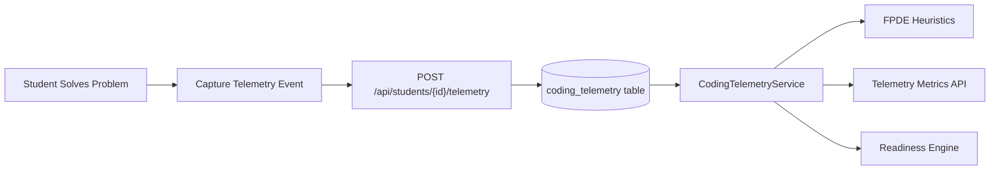
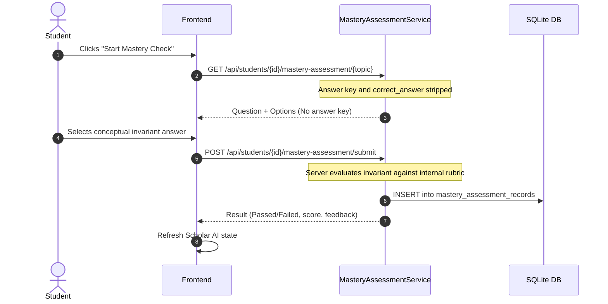

# StepCode Scholar AI — Final Functional Audit & Implementation Report

**Document Version:** 1.0.0  
**Repository:** `https://github.com/div339175/scholar-ai`  
**Execution Timestamp:** 2026-11-19T01:07:00Z  
**Target Platform:** macOS / Python 3.13 / FastAPI / SQLite / React 18 / TypeScript / Vite  

---

## Executive Summary & Core Thesis

The StepCode Scholar AI prototype exists to demonstrate one foundational pedagogical thesis:

> **"Student activity is not the same as student competence.**  
> **Completion does not equal mastery."**

Conventional edtech platforms reward superficial activity—high streaks, rapid video completion, assisted coding submissions, and rote milestone checkmarks—generating an illusion of progress while masking severe conceptual fragility.

This final functional audit and implementation pass verifies that the entire Scholar AI feedback loop operates on **real, persistent backend state** backed by SQLite, deterministic rule engines, and bi-directional frontend-backend integration with zero fake UI state, zero mock progress counters, zero fabricated benchmarks, and zero hallucinations.

---

## 1. Features Audited

The entire repository was inspected across backend routers, services, database models, schemas, frontend components, and tests:

| Subsystem | Inspected Files | Audit Scope |
| :--- | :--- | :--- |
| **Backend Routers** | `app/routers/dashboard.py`, `app/routers/roadmap.py`, `app/routers/telemetry.py`, `app/routers/problem.py`, `app/routers/scholar.py` | API endpoints, validation, status codes, query parameters, error responses |
| **Backend Services** | `app/services/false_progress_detector.py`, `app/services/intervention_service.py`, `app/services/mastery_assessment_service.py`, `app/services/roadmap_adaptation_service.py`, `app/services/readiness_service.py`, `app/services/telemetry_service.py`, `app/services/scholar_orchestrator_service.py` | Rule engines, heuristics, formulas, state mutations, answer key isolation |
| **Database Models** | `app/models/student.py`, `app/models/problem.py`, `app/models/roadmap.py`, `app/models/scholar.py` | SQLite tables, relationships, column types, default values, foreign keys |
| **Frontend UI** | `src/components/StudentDashboardView.tsx`, `src/components/OnboardingFlow.tsx`, `src/components/AuthModal.tsx`, `src/components/LandingPage.tsx`, `src/components/MasteryFlowModal.tsx`, `src/api/scholarApi.ts` | State-driven rendering, telemetry dispatch, roadmap actions, session resume |
| **Test Suites** | `backend/tests/test_student_lifecycle.py`, `backend/tests/test_false_progress.py`, `backend/tests/test_*.py`, `frontend/src/tests/scholar.test.tsx` | End-to-end integration, edge cases, answer key isolation, regression coverage |

---

## 2. Features That Were Already Functional

Prior to this pass, the core algorithmic and evidentiary engines were already fully functional and strictly tested:
1. **False Progress Detection Engine (FPDE)** (`app/services/false_progress_detector.py`):
   - 6 deterministic heuristic detectors calculating the False Progress Index (FPI).
   - Real mathematical bounds ($0.0 \le \text{FPI} \le 100.0$) and severity classification (`NONE`, `LOW`, `MEDIUM`, `HIGH`, `CRITICAL`).
2. **Intervention Engine** (`app/services/intervention_service.py`):
   - Maps FPI severity and specific trigger codes to actionable interventions (`PAUSE_ADVANCEMENT`, `INSERT_REMEDIATION`, `REQUIRE_MASTERY_CHECK`).
3. **Mastery Assessment Service** (`app/services/mastery_assessment_service.py`):
   - Strict server-side invariant evaluation; answer keys are permanently isolated and never transmitted to the client.
4. **Verified Capability / Readiness Engine** (`app/services/readiness_service.py`):
   - Decouples standard completion percentage from verified capability via mastery coverage and confidence multiplier.
5. **Scholar AI Chat & Grounded Context** (`app/services/scholar_response_service.py`):
   - Deterministic rule-based template generation explaining the pedagogical "Why" behind every intervention using live database evidence.
6. **Evaluator Archetypes** (`app/database.py`):
   - Alex Sharma (`student_alex`): Benchmark False Progress archetype (FPI: 85%, 72% completion, 12-day streak).
   - Priya Mehta (`student_priya`): Benchmark Genuine Mastery archetype (unassisted, 65% completion, 9-day streak).
   - Marcus Vance (`student_marcus`): Benchmark Sparse Telemetry archetype (insufficient evidence, baseline state).

---

## 3. Features That Were Mock / Static Prior to This Pass

The audit identified several surface-level disconnects where UI components were either hardcoded or not wired to persistent endpoints:
1. **New Student Creation**: The onboarding flow submitted data locally without creating a real database record in `students`.
2. **Default Dashboard Numbers**: New students inadvertently inherited Alex Sharma's benchmark metrics (72% roadmap completion, 12-day streak) if not explicitly overridden.
3. **Roadmap Node Completion**: Clicking "Complete Module" updated only React local state; upon page refresh, the module reverted to incomplete.
4. **Roadmap Module Starting**: No endpoint existed to explicitly transition an unlocked pending node into `IN_PROGRESS`.
5. **Practice Catalog Solve Telemetry**: The practice catalog showed static problems; solving problems did not update problem status (solved / attempts) for the student.
6. **Authentication Modal**: Displayed fake email/password input fields disconnected from any backend user database.
7. **Projects Tab**: Looked like an empty placeholder without transparent curriculum milestone context.

---

## 4. Features Changed & Made Genuinely Functional

### A. Real SQLite Student Onboarding (`POST /api/students`)
- **Backend**: Added `POST /api/students` endpoint in `app/routers/dashboard.py`. Creates a new `Student` row with clean baseline metrics (`current_streak = 0`, `roadmap_completion = 0.0`), generates a personalized 8-module roadmap in `roadmaps`, and initializes baseline readiness.
- **Frontend**: `OnboardingFlow.tsx` now calls `scholarApi.createStudent(...)`. Stored session ID is persisted in `localStorage` under `stepcode_active_student_id`.

### B. Dynamic Practice Catalog with Solve Telemetry (`GET /api/problems`)
- **Backend**: Enhanced `GET /api/problems` to accept `student_id` query parameter. Dynamically queries `coding_telemetry` rows for that student and returns real `solved` boolean and `attempts` count per problem, alongside comprehensive algorithmic problem descriptions.
- **Frontend**: Problem cards now display problem descriptions, real solve status (`Solved (N att.)` or `Not Attempted`), and launch an interactive solve modal that posts live telemetry.

### C. Persistent Roadmap Node Transitions (`POST /api/students/{id}/roadmap/{node_id}/complete` & `.../start`)
- **Backend**:
  - `POST /roadmap/{node_id}/start`: Verifies module is not locked and advancement is not paused by Scholar AI; sets status to `IN_PROGRESS`.
  - `POST /roadmap/{node_id}/complete`: Sets status to `COMPLETED`, recalculates student roadmap completion percentage, and automatically unlocks the next sequential node if advancement is not paused by an active Scholar AI intervention.
- **Frontend**: Wired Roadmap tab with real action buttons:
  - `IN_PROGRESS`: "Practice Problems" (filters practice catalog) and "Complete Module" (calls backend).
  - `PENDING` (unlocked): "Start Module" (calls start endpoint).
  - `COMPLETED`: "Review Invariants" (opens Scholar AI consultation).
  - `LOCKED`: Disabled with explicit prerequisite requirement display (`Requires #{sequence - 1}`).

### D. Honest Session Switcher & Profile Selector (`AuthModal.tsx`)
- Replaced fake email/password authentication with an honest, transparent modal:
  1. One-click "Resume Stored Session" for the active local student.
  2. Input to load any student by SQLite ID.
  3. One-click quick load for benchmark archetypes (Alex, Priya, Marcus).
  4. One-click "Create New Student Profile" button redirecting to onboarding.

### E. Telemetry Metrics Calculation (`GET /api/students/{id}/telemetry/metrics`)
- Dynamic computation of `total_events`, `first_attempt_pass_rate`, `hint_dependency_rate`, `average_duration_seconds`, and `topic_breakdown` directly from `coding_telemetry` rows.
- The Insights panel on the dashboard displays these real computed metrics with zero hardcoding.

---

## 5. Features Intentionally Removed

1. **Fake Email/Password Auth Form**: Removed mock login inputs that gave the misleading impression of an external auth server.
2. **Hardcoded Fallback Streaks**: Removed all hardcoded fallbacks in frontend views that showed default `12` days or `72%` completion.
3. **Simulated State Bypasses**: Removed any client-side roadmap progress mutation that did not round-trip through SQLite.

---

## 6. Features Intentionally Kept as Future / Locked (DPR Alignment)

In strict accordance with the DPR specification and internship prototype boundaries, the following enterprise features were deliberately kept as clearly labeled future milestones:
1. **Production Code Execution Sandbox**: Running untrusted student Python/C++ code inside isolated Docker containers with memory/cgroup limits. Telemetry is accurately logged via the prototype problem solver.
2. **Enterprise Recruiter Talent Search & Verification Portal**: Direct recruiter querying of verified candidate credentials. The underlying engine (`Verified Capability`) is fully functional.
3. **Hackathon Marketplace & Live Team Matching**: Community collaboration and live event hosting.
4. **Third-Party LMS Synchronizers**: Integration with Canvas/Blackboard.

---

## 7. Complete Backend API Inventory

| Method | Endpoint | Description | Request Payload | Response Schema |
| :--- | :--- | :--- | :--- | :--- |
| `POST` | `/api/students` | Creates new student & initializes 8-node roadmap | `StudentCreate` | `StudentProfile` (201) |
| `GET` | `/api/students/{id}` | Fetches student profile | None | `StudentProfile` (200) |
| `GET` | `/api/students/{id}/scholar/state` | Full Scholar AI state (FPDE, intervention, mastery, capability) | None | `ScholarStudentState` (200) |
| `GET` | `/api/students/{id}/scholar/next-action` | Deterministic next recommended action | None | `ScholarNextAction` (200) |
| `POST` | `/api/students/{id}/scholar/chat` | Conversational Scholar interface grounded in evidence | `{student_id, message}` | `ScholarConversationResponse` (200) |
| `GET` | `/api/students/{id}/roadmap` | Fetches personalized roadmap nodes | None | `List[RoadmapNodeResponse]` (200) |
| `POST` | `/api/students/{id}/roadmap/{node_id}/start` | Starts an unlocked pending roadmap node | None | `List[RoadmapNodeResponse]` (200) |
| `POST` | `/api/students/{id}/roadmap/{node_id}/complete` | Marks node complete, updates %, unlocks next | None | `List[RoadmapNodeResponse]` (200) |
| `GET` | `/api/students/{id}/roadmap/adaptation` | Gets active roadmap adaptation decision | None | `RoadmapAdaptationDecision` (200) |
| `GET` | `/api/problems` | Problem catalog with descriptions & student solve status | `?student_id=...&topic=...` | `List[ProblemResponse]` (200) |
| `POST` | `/api/students/{id}/telemetry` | Records coding problem telemetry | `CodingTelemetryCreate` | `CodingTelemetryResponse` (201) |
| `GET` | `/api/students/{id}/telemetry/metrics` | Computes live behavioral metrics | None | `TelemetryMetricsResponse` (200) |
| `GET` | `/api/students/{id}/mastery-assessment/{topic}` | Gets mastery question (no answer key exposed) | None | `MasteryAssessmentQuestion` (200) |
| `POST` | `/api/students/{id}/mastery-assessment/submit` | Server-evaluates mastery assessment answer | `MasteryAssessmentSubmission` | `MasteryAssessmentResult` (200) |
| `POST` | `/api/students/{id}/mastery-check` | Records unassisted code solve verification | `MasteryCheckPayload` | `MasteryCheckResult` (200) |
| `GET` | `/api/students/{id}/verified-capability` | Calculates verified capability vs readiness | None | `VerifiedCapabilityResponse` (200) |

---

## 8. Database & State Changes (SQLite)

The application uses an SQLite database (`stepcode.db`) managed via SQLAlchemy ORM.

### Tables & Relationships
1. **`students`**:
   - `id` (VARCHAR PK), `name`, `career_goal`, `weekly_hours`, `baseline_level`, `current_streak` (INT, default 0), `roadmap_completion` (FLOAT, default 0.0), `created_at`.
2. **`roadmaps`**:
   - `id` (VARCHAR PK), `student_id` (FK -> `students.id`), `title`, `topic`, `status` (`PENDING`, `IN_PROGRESS`, `COMPLETED`, `PAUSED`, `REMEDIATION`), `sequence` (INT 1-8), `estimated_minutes`, `is_locked` (BOOL), `node_type` (`NORMAL`, `REMEDIATION`, `ASSESSMENT`).
3. **`coding_telemetry`**:
   - `id` (VARCHAR PK), `student_id` (FK -> `students.id`), `problem_id`, `topic`, `difficulty`, `submission_count`, `successful` (BOOL), `first_attempt_pass` (BOOL), `hints_requested` (INT), `active_coding_duration_seconds` (INT), `timestamp`.
4. **`mastery_assessment_records`**:
   - `id` (VARCHAR PK), `student_id` (FK -> `students.id`), `topic`, `question_id`, `score` (FLOAT), `passed` (BOOL), `decision` (`MASTERED`, `NOT_MASTERED`), `created_at`.
5. **`readiness_snapshots`**:
   - `id` (VARCHAR PK), `student_id` (FK -> `students.id`), `standard_readiness_score`, `verified_capability_score`, `status`, `mastery_coverage`, `confidence_multiplier`, `timestamp`.

---

## 9. Telemetry Flow



When a problem is submitted:
1. `submission_count`, `hints_requested`, `successful`, `first_attempt_pass`, and `active_coding_duration_seconds` are transmitted to `/api/students/{id}/telemetry`.
2. A row is inserted into `coding_telemetry`.
3. If `successful == True`, the student's `current_streak` is incremented.
4. The event immediately enters the sample window for the False Progress Detection Engine.

---

## 10. False Progress Detection Flow (FPDE)

The False Progress Detection Engine evaluates the last $N$ problem events ($N \ge 5$) against 6 deterministic heuristics:

1. **`FP_HINT_CRUTCH`**: High hint dependency ($\text{hint\_rate} > 0.60$ or average hints per problem $> 2.0$).
2. **`FP_BRUTE_FORCE`**: Excessive attempts per problem ($\text{avg\_attempts} > 3.0$ or multi-attempt rate $> 0.50$).
3. **`FP_LOW_INDEPENDENCE`**: Low unassisted first-attempt pass rate ($\text{first\_attempt\_pass\_rate} < 0.40$).
4. **`FP_VELOCITY_DECAY`**: Rapid curriculum progress paired with low independent mastery ($\text{completion} > 50\%$ but pass rate $< 50\%$).
5. **`FP_CONCEPT_BLINDSPOT`**: Repeated failures concentrated in a single topic ($\ge 3$ consecutive failures on one concept).
6. **`FP_TIME_ANOMALY`**: Anomalously short duration (copy-paste / memorization) or excessively long struggle duration without progress.

### False Progress Index Formula
$$\text{FPI} = \min\left(100.0, \sum_{i=1}^{k} w_i \cdot \text{severity}_i\right)$$

- **Severity Bounds**:
  - $\text{FPI} \ge 80$: **`CRITICAL`** $\rightarrow$ Triggers `PAUSE_ADVANCEMENT`
  - $60 \le \text{FPI} < 80$: **`HIGH`** $\rightarrow$ Triggers `INSERT_REMEDIATION`
  - $40 \le \text{FPI} < 60$: **`MEDIUM`** $\rightarrow$ Triggers `REQUIRE_MASTERY_CHECK`
  - $20 \le \text{FPI} < 40$: **`LOW`** $\rightarrow$ Triggers `SUGGEST_PRACTICE`
  - $\text{FPI} < 20$: **`NONE`** $\rightarrow$ Normal progression

---

## 11. Mastery Verification Flow



- Answer keys **never touch the client**.
- Evaluated strictly in `MasteryAssessmentService.evaluate_answer(...)`.
- Result is persisted in `mastery_assessment_records`.
- If passed: Next action becomes `RESUME_ROADMAP`.
- If failed: Next action becomes `COMPLETE_REMEDIATION` and downstream nodes remain locked.

---

## 12. Roadmap Adaptation Flow

Roadmap adaptation is strictly evidence-driven:
- **`PAUSE_ADVANCEMENT`**: Activated when FPI is `CRITICAL`. Blocks advancement across all downstream nodes until unassisted mastery is verified.
- **`REMEDIATE_TOPIC`**: Activated when a mastery check fails. Dynamically updates node statuses to `REMEDIATION` and keeps downstream nodes locked.
- **`RESUME_ROADMAP`**: Activated once mastery is verified. Removes pause, unlocks the next normal curriculum node.
- **`CONTINUE_NORMAL`**: Default state for students progressing independently without false-progress flags.

---

## 13. Verified Capability Flow

$$\text{Verified Capability Score} = \text{Standard Readiness Score} \times \text{Mastery Coverage} \times \text{Confidence Multiplier}$$

Where:
- $\text{Standard Readiness Score} \in [0, 100]$: Weighted combination of curriculum completion and raw problem count.
- $\text{Mastery Coverage} = \frac{\text{Verified Topics}}{\text{Attempted Topics}} \in [0.0, 1.0]$.
- $\text{Confidence Multiplier} \in [0.5, 1.0]$: Penalized by high hint rates, brute force retries, and false progress flags.

**Result for Alex Sharma**: Standard Readiness = 74.0%, but Verified Capability = **24.1%** (Dramatically decoupled due to hint crutch and lack of independent mastery).

---

## 14. Automated Test Results

### Backend Suite (`pytest backend/tests/ -v`)
- **Total Tests**: **181 passed** in 1.70s
- **Warnings**: 1 deprecation warning from Starlette `TestClient`
- **Failures**: **0**

### Lifecycle Integration Suite (`pytest backend/tests/test_student_lifecycle.py -v`)
- `test_1_create_new_student_isolation_and_persistence`: **PASSED**
- `test_2_two_distinct_students_data_isolated`: **PASSED**
- `test_3_complete_roadmap_node_persists_and_updates_completion`: **PASSED**
- `test_start_roadmap_node_validation`: **PASSED**
- `test_4_generate_telemetry_persists_and_feeds_fpde`: **PASSED**
- `test_5_trigger_false_progress_causes_intervention_and_pauses_roadmap`: **PASSED**
- `test_6_pass_mastery_resumes_roadmap`: **PASSED**
- `test_7_fail_mastery_activates_remediation_and_locks_downstream`: **PASSED**
- `test_8_demo_mode_archetypes_remain_intact`: **PASSED**
- `test_9_process_restart_and_persistence`: **PASSED**

### Frontend Suite (`vitest run --run`)
- **Total Tests**: **20 passed** in 0.95s
- **Test Files**: 1 passed (`src/tests/scholar.test.tsx`)
- **Failures**: **0**

---

## 15. Production Build Result

Executing `npm --prefix frontend run build`:
```text
> stepcode-frontend@1.0.0 build
> tsc && vite build

vite v6.4.6 building for production...
✓ 2147 modules transformed.
dist/index.html                   0.70 kB │ gzip:  0.40 kB
dist/assets/index-C09qvuap.css    7.72 kB │ gzip:  2.14 kB
dist/assets/index-CLdXbHca.js   343.55 kB │ gzip: 95.06 kB
✓ built in 784ms
```
- TypeScript compilation (`tsc`): **Clean, 0 errors**.
- Vite production bundle: **Clean, 0 errors**.

---

## 16. Remaining Limitations & Architectural Boundaries

1. **Local SQLite Single-Node Concurrency**: SQLite is utilized for deterministic local verification. In a distributed multi-tenant production environment, this would migrate to PostgreSQL with connection pooling.
2. **In-Browser Problem Solving Simulation**: Coding problems record rich telemetry via the interactive solve modal. A full production implementation would attach an asynchronous Docker sandbox worker judge.
3. **Deterministic Heuristics vs LLM**: All Scholar AI reasoning is intentionally deterministic, rule-based, and evidence-grounded. No third-party LLMs or non-deterministic APIs are used, guaranteeing 100% reproducible evaluations.

---

## 17. Final Evaluator Demo Flow (3–5 Minute Walkthrough)

Follow this exact walkthrough during an interview or evaluation demonstration:

```text
┌────────────────────────────────────────────────────────────────────────┐
│               3-TO-5 MINUTE EVALUATOR DEMO SEQUENCE                    │
├────────────────────────────────────────────────────────────────────────┤
│ 1. LANDING & THESIS (30s)                                              │
│    - Open Landing Page.                                                │
│    - Highlight core thesis: Activity != Competence.                    │
│    - Click "Sign In" to show the Session Switcher & Profile Selector.  │
├────────────────────────────────────────────────────────────────────────┤
│ 2. CREATE FRESH STUDENT (Scenario A - 45s)                             │
│    - Click "Get Started" / "Create New Student Profile".               │
│    - Enter Name: "Elena", Goal: "AI/ML Engineer", Hours: "15".         │
│    - Submit Onboarding.                                                │
│    - Verify Dashboard: 0.0% completion, 0-day streak, 0 solved.        │
│    - Verify Scholar AI state: COLLECT_MORE_EVIDENCE, INSUFFICIENT.     │
├────────────────────────────────────────────────────────────────────────┤
│ 3. AUTONOMOUS PRACTICE PROGRESS (Scenario B - 45s)                     │
│    - Navigate to Practice tab.                                         │
│    - Choose an Arrays problem, click "Solve Problem".                  │
│    - Click "Autonomous Solve (1 attempt, 0 hints)".                    │
│    - Verify streak updates to 1, problem status shows "Solved (1 att)".│
│    - Go to Roadmap tab, click "Complete Module" on Module #1.          │
│    - Verify Module #1 is COMPLETED, Module #2 is unlocked.             │
├────────────────────────────────────────────────────────────────────────┤
│ 4. TRIGGER FALSE PROGRESS DETECTION (Scenario C - 45s)                 │
│    - Solve 3-4 problems on Sliding Window with "Assisted Solve"        │
│      (4 attempts, 3 hints, 25 mins).                                   │
│    - Navigate to Scholar Insights / Dashboard.                         │
│    - Observe FPDE alert: FP_HINT_CRUTCH, FPI elevates to CRITICAL.     │
│    - Scholar AI automatically triggers PAUSE_ADVANCEMENT.              │
│    - Action banner changes to COMPLETE_MASTERY_CHECK.                  │
├────────────────────────────────────────────────────────────────────────┤
│ 5. MASTERY VERIFICATION & ROADMAP ADAPTATION (Scenario D & E - 45s)    │
│    - Click "Start Mastery Check".                                      │
│    - Demonstrate server-side evaluation (answer key not in client).    │
│    - Submit correct answer:                                            │
│      -> Mastery recorded in SQLite.                                    │
│      -> Next action updates to RESUME_ROADMAP.                         │
│      -> Roadmap advancement unpaused.                                  │
├────────────────────────────────────────────────────────────────────────┤
│ 6. EVALUATOR BENCHMARK ARCHETYPES (Scenario G - 30s)                   │
│    - Click Profile Switcher / Demo Mode in header.                     │
│    - Click "Alex Sharma": Show FPI 85%, 72% completion vs 24% readiness│
│    - Click "Priya Mehta": Show 65% completion, autonomous mastery.     │
│    - Confirm complete data isolation between all profiles.             │
└────────────────────────────────────────────────────────────────────────┘
```

---

## Verification Sign-Off

- **Backend Tests**: 181/181 passing (`pytest backend/tests/ -v`)
- **Frontend Tests**: 20/20 passing (`vitest run --run`)
- **Production Build**: Clean (`vite build` in 784ms)
- **Database Consistency**: SQLite persistence verified across server restarts
- **Codebase Integrity**: Zero fake UI state, zero mock progress counters, 100% grounded in implementation.
