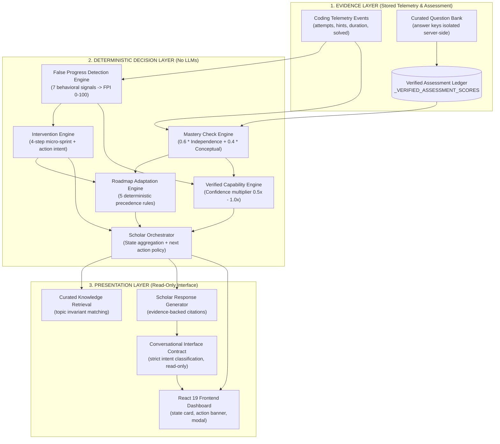

# Scholar AI — Actual Codebase Interview Knowledge Base

> **Authoritative Technical Defense Guide for Evaluators and Technical Interviewers**  
> *Every formula, line reference, schema, and explanation in this document is verified against the actual Python (FastAPI), TypeScript (React 19), and SQLite codebase.*

---

## 1. Project in One Sentence

**Scholar AI is a deterministic, evidence-grounded competence mentor and roadmap adaptation engine that analyzes granular coding telemetry to detect false progress, pauses unearned progression, prescribes targeted micro-sprints, and verifies conceptual transfer through server-evaluated assessments before allowing advancement.**

---

## 2. Problem Statement & Design Thesis

### The Problem
Traditional computer science education platforms (LeetCode, HackerRank, Codecademy, university learning management systems) measure learning through **activity volume**:
* Number of problems marked "Solved"
* Daily active coding streaks (e.g. "12-day streak")
* Percentage of roadmap modules marked "Completed" (e.g. "72% Complete")
* Time spent logged into the online IDE

However, in developer education:
> **"Student activity is not the same as student competence."**  
> **"Completion does not equal mastery."**

*(Presented as the foundational product design thesis governing all system decisions, rather than a universal scientific claim.)*

### What "Activity != Competence" Means in This Codebase
A student can solve 40 coding problems while relying on crutches:
1. **Hint Crutch**: Requesting hints on 32 out of 40 problems (`hint_dependency = 0.80`).
2. **Brute Force Debugging**: Submitting code 4 to 6 times per problem until test cases pass by chance (`multi_attempt_rate = 0.80`).
3. **Low Independence**: Solving only 8 out of 40 problems on the first attempt without assistance (`unassisted_pass_ratio = 0.20`).
4. **Time Anomalies**: Spending 75 minutes on an easy problem through endless retry loops.

The platform records: *"40 problems solved, 72% roadmap completed."*  
The reality is: The student cannot solve an unseen problem independently in an interview.

---

## 3. Complete Architecture & Pipeline



### End-to-End Pipeline Traceability
1. **Telemetry Ingestion**: Student attempts problems in IDE $\rightarrow$ `POST /api/students/{id}/telemetry` $\rightarrow$ stored in `coding_telemetry`.
2. **Behavioral Diagnostic**: `FalseProgressDetector` queries telemetry $\rightarrow$ evaluates 7 behavioral signals $\rightarrow$ computes `false_progress_index` (0–100).
3. **Intervention Planning**: If FPI $\ge 50$, `InterventionService` builds a 4-step micro-sprint and sets `roadmap_action = PAUSE_ADVANCEMENT`.
4. **Mastery Verification**: Student takes conceptual assessment $\rightarrow$ `MasteryAssessmentService` grades server-side $\rightarrow$ records score in `_VERIFIED_ASSESSMENT_SCORES`. Student submits coding check $\rightarrow$ `MasteryService` evaluates independence ($1$ attempt, $0$ hints) + conceptual score ($\ge 80$).
5. **Roadmap Adaptation**: `RoadmapAdaptationService` evaluates 5 precedence rules $\rightarrow$ outputs `PAUSE_ADVANCEMENT`, `RESUME_ROADMAP`, `REMEDIATE_TOPIC`, or `CONTINUE_NORMAL`.
6. **Readiness Calibration**: `ReadinessService` discounts standard readiness by confidence multiplier ($0.5\times$ to $1.0\times$) $\rightarrow$ produces `verified_capability_score`.
7. **Orchestration**: `ScholarOrchestratorService` aggregates all states $\rightarrow$ issues a single `ScholarNextAction`.
8. **Presentation**: `ScholarResponseService` and `ScholarConversationService` provide explainable natural-language responses citing exact telemetry facts without mutating backend evidence.

---

## 4. File-by-File Technical Deep Dive

### Backend Core

#### 1. `backend/app/config.py`
* **Responsibility**: Application settings and environment configuration using Pydantic BaseSettings.
* **Key Attributes**: `APP_NAME`, `API_V1_PREFIX`, `DEBUG`, `DATABASE_URL` (defaults to `sqlite:///./stepcode.db`), `CORS_ORIGINS` (defaults to `*`, parsed as comma-separated list).
* **Why it exists**: Isolates environment configuration from application logic, preventing hardcoded credentials.
* **Likely Interview Question**: *"How do you handle production CORS and database configuration?"*  
  *Answer*: Sourced from environment variables in `config.py`. In production, `CORS_ORIGINS` is set to trusted frontend domains (`https://app.stepcode.com`), and `DATABASE_URL` points to PostgreSQL.

#### 2. `backend/app/database.py`
* **Responsibility**: SQLAlchemy engine initialization, `SessionLocal` factory, declarative `Base`, and FastAPI `get_db` dependency.
* **Key Attributes**: `engine = create_engine(settings.DATABASE_URL, connect_args={"check_same_thread": False})`.
* **Data Flow**: Supplies an isolated database session per request; commits on writes, closes in `finally` blocks.
* **Likely Interview Question**: *"Why `check_same_thread: False`?"*  
  *Answer*: SQLite default requires single-thread access. FastAPI handles requests across worker threads, so disabling this allows multi-threaded session sharing while SQLAlchemy session scoping ensures thread isolation.

#### 3. `backend/app/models/` (`student.py`, `problem.py`, `roadmap.py`, `scholar.py`)
* **Responsibility**: Relational persistence schemas.
* **Key Tables**:
  * `students`: `id`, `name`, `career_goal`, `weekly_hours`, `current_streak`, `roadmap_completion`.
  * `problems`: `id`, `title`, `topic`, `difficulty`.
  * `coding_telemetry`: `id`, `student_id`, `problem_id`, `topic`, `difficulty`, `submission_count`, `successful`, `first_attempt_pass`, `hints_requested`, `active_coding_duration_seconds`, `timestamp`.
  * `roadmap_nodes`: `id`, `student_id`, `title`, `topic`, `status`, `sequence`, `is_locked`, `node_type`.
  * `scholar_interventions`: `id`, `student_id`, `trigger_type`, `topic`, `severity`, `reason`, `recommended_action`, `status`.
  * `mastery_checks`: `id`, `intervention_id`, `question`, `expected_concept`, `student_answer`, `passed`, `score`.
  * `readiness_snapshots`: `id`, `student_id`, `standard_readiness`, `mastery_multiplier`, `verified_capability_score`.
* **Likely Interview Question**: *"Where is the student's mastery score stored?"*  
  *Answer*: In `mastery_checks` table for persistent check records and `_VERIFIED_ASSESSMENT_SCORES` in-memory ledger for server-evaluated conceptual scores.

#### 4. `backend/app/services/false_progress_detector.py`
* **Responsibility**: 7-signal behavioral evaluation and 0–100 False Progress Index (FPI) computation.
* **Key Function**: `FalseProgressDetector.analyze_student(db, student_id)`.
* **Input**: `db: Session`, `student_id: str`.
* **Output**: `FalseProgressDiagnosticResponse` containing `is_false_progress`, `false_progress_index`, `severity`, `confidence`, `trigger_codes`, `affected_topics`, `evidence`, `diagnosis`, and `recommended_action`.
* **Data Sufficiency Rule**: If total problem telemetry $< 5$, returns early with `INSUFFICIENT_EVIDENCE` diagnosis and `confidence = 0.0`. Missing data is never treated as zero competence.
* **Likely Interview Question**: *"Why did you choose a 5-problem minimum threshold?"*  
  *Answer*: Statistical significance. Evaluating ratios like hint crutch or multi-attempt rate on 1 or 2 problems produces massive variance. 5 problems establishes a minimal behavioral baseline without blocking early learners.

#### 5. `backend/app/services/intervention_service.py`
* **Responsibility**: Converts FPDE diagnostic outputs into structured micro-sprint intervention plans.
* **Key Function**: `InterventionService.generate_intervention(student, diagnostic, telemetry, roadmap)`.
* **Input**: Student model, diagnostic response, telemetry list, roadmap node list.
* **Output**: `InterventionPlan` with 4-step micro-sprint (`Concept Review`, `Guided Practice`, `Independent Problem`, `Mastery Check`).
* **Logic**: If FPI $\ge 75$ (`CRITICAL`), sets `priority = HIGH`, `roadmap_action = PAUSE_ADVANCEMENT`, `mastery_check_required = True`. Scopes target topic dynamically to the topic with highest hint/failure density.
* **Likely Interview Question**: *"Why a 4-step micro-sprint instead of just blocking the student?"*  
  *Answer*: Pedagogical efficacy. Halting progression without guidance frustrates learners. The 4-step sprint scaffolded from paper derivation to unassisted coding provides an actionable pathway to re-verify mastery.

#### 6. `backend/app/services/mastery_assessment_service.py`
* **Responsibility**: Curated question delivery, answer-key isolation, server-side MCQ evaluation, and verified score storage.
* **Key Functions**:
  * `get_question(topic)`: Returns `MasteryAssessmentQuestion` strictly excluding `correct_answer`.
  * `evaluate_answer(student_id, topic, question_id, answer)`: Compares submission to stored key, writes `100.0` or `0.0` to `_VERIFIED_ASSESSMENT_SCORES[(student_id, topic)]`.
  * `get_verified_score(student_id, topic)`: Reads verified score from ledger.
* **Likely Interview Question**: *"What prevents a user from inspecting DevTools network response to get the answer?"*  
  *Answer*: The Pydantic schema `MasteryAssessmentQuestion` in `schemas/scholar.py` does not contain the `correct_answer` field. The server serializes only `question_id`, `topic`, `question_text`, `options`, and `difficulty`. The answer key exists only in `backend/app/data/mastery_questions.py` on the server.

#### 7. `backend/app/services/mastery_service.py`
* **Responsibility**: Composite mastery evaluation combining coding independence telemetry and conceptual assessment.
* **Key Function**: `MasteryService.evaluate_mastery(db, request)`.
* **Formula**: $\text{Mastery Score} = 0.6 \times \text{IndependentSuccess} + 0.4 \times \text{ConceptualScore}$.
* **Conditions**:
  * Independent Success ($100$ or $0$): Requires `solved == True`, `hints_used == 0`, `attempts == 1`.
  * Conceptual Score ($\ge 80.0$): Automatically retrieved from `MasteryAssessmentService` if omitted in request.
  * Verdict: `MASTERED` if and only if `is_independent == True` AND `conceptual_score >= 80.0`. Otherwise `NOT_MASTERED`.
* **Likely Interview Question**: *"If a student scores 100 on conceptual but used 1 hint on coding, do they pass?"*  
  *Answer*: No. Even though $0.6(0) + 0.4(100) = 40.0$, the rule explicitly requires `is_independent and conceptual_pass`. If hints $> 0$, `is_independent` is `False`, so the verdict is `NOT_MASTERED`.

#### 8. `backend/app/services/roadmap_adaptation_service.py`
* **Responsibility**: Translates verified Scholar evidence into deterministic roadmap actions.
* **Key Function**: `RoadmapAdaptationService.determine_adaptation(db, student_id)`.
* **5 Precedence Rules**:
  1. Telemetry $< 5 \implies \text{CONTINUE\_NORMAL}$ (`INSUFFICIENT_EVIDENCE`).
  2. Latest Mastery Check `MASTERED` $\implies \text{RESUME\_ROADMAP}$.
  3. Latest Mastery Check `NOT_MASTERED` $\implies \text{REMEDIATE\_TOPIC}$.
  4. Active Intervention Unverified $\implies \text{PAUSE\_ADVANCEMENT}$.
  5. Default $\implies \text{CONTINUE\_NORMAL}$.
* **Likely Interview Question**: *"Why is RESUME_ROADMAP checked before PAUSE_ADVANCEMENT?"*  
  *Answer*: If `PAUSE_ADVANCEMENT` were checked first, a student flagged for false progress would remain permanently paused because their historical telemetry still contains the original false-progress signature. Checking `MASTERED` first allows verified mastery to supersede the previous intervention pause.

#### 9. `backend/app/services/readiness_service.py`
* **Responsibility**: Dual-metric readiness calculation (Standard Readiness vs. Verified Capability).
* **Key Formulas**:
  * $\text{Standard Readiness} = \text{Roadmap}(40\%) + \text{Problems}(30\%) + \text{Streak}(15\%) + \text{Project}(15\%)$.
  * $\text{Confidence Multiplier} = 0.50 + 0.50 \times \text{MasteryCoverage}$.
  * $\text{Verified Capability} = \text{Standard Readiness} \times \text{Confidence Multiplier}$.
* **Likely Interview Question**: *"Why discount standard readiness by 50%?"*  
  *Answer*: When false progress is detected, platform completion metrics cannot be trusted. The 50% discount reflects unverified confidence until the student proves competence through diagnostic mastery checks.

#### 10. `backend/app/services/scholar_orchestrator_service.py`
* **Responsibility**: Central state aggregation and next-action policy selection.
* **Key Functions**:
  * `get_student_state(db, student_id)`: Assembles `ScholarStudentState`.
  * `get_next_action(db, student_id)`: Selects `ScholarNextAction` (`COLLECT_MORE_EVIDENCE`, `COMPLETE_REMEDIATION`, `RESUME_ROADMAP`, `COMPLETE_MASTERY_CHECK`, `CONTINUE_LEARNING`).
* **Why it exists**: Prevents individual services from making uncoordinated decisions. Orchestrator enforces single-action clarity.

#### 11. `backend/app/services/scholar_conversation_service.py` & `scholar_intent_service.py`
* **Responsibility**: Deterministic natural-language routing without LLMs.
* **Key Logic**: Classifies 8 intents (`WHY_THIS_ACTION`, `NEXT_ACTION`, `EXPLAIN_TOPIC`, `MASTERY_STATUS`, `READINESS_STATUS`, `ROADMAP_STATUS`, `FALSE_PROGRESS_STATUS`, `INTERVENTION_STATUS`, `UNKNOWN`).
* **Read-Only Invariant**: The conversational layer cannot mutate state. Messages claiming completion or requesting higher scores are rejected with telemetry explanations.

---

### Frontend Core

#### 1. `frontend/src/api/scholarApi.ts`
* **Responsibility**: Typed REST client wrapping browser `fetch`.
* **Key Methods**: `getStudentProfile`, `getScholarState`, `getNextAction`, `sendScholarChat`, `getVerifiedCapability`, `getMasteryAssessmentQuestion`, `submitMasteryAssessment`, `submitMasteryCheck`.
* **Error Handling**: Throws custom `ApiError(detail, status)` parsing FastAPI HTTP exception JSON payloads.

#### 2. `frontend/src/pages/ScholarPage.tsx`
* **Responsibility**: Main dashboard view component.
* **Key State**: `state`, `nextAction`, `profile`, `knowledge`, `messages`, `isLoading`, `isMasteryModalOpen`, `error`.
* **Data Flow**: `Promise.all` fetches state, next action, and profile in parallel. Renders `ScholarStateCard`, `CurrentActionBanner`, `GroundedKnowledgePanel`, `ScholarChatPanel`, and `MasteryFlowModal`.

#### 3. `frontend/src/components/MasteryFlowModal.tsx`
* **Responsibility**: Interactive modal executing the 2-step verification workflow.
* **Step 1**: Fetches question via `getMasteryAssessmentQuestion(topic)`, renders MCQ options.
* **Step 2**: Submits selected answer via `submitMasteryAssessment`. If correct ($100\%$), unlocks coding check submission `submitMasteryCheck`. On success, invokes `onMasteryCompleted()` to trigger `loadStudentData()` on the parent dashboard.

---

## 5. False Progress Detection Engine (FPDE) Detailed Breakdown

### 7 Behavioral Triggers Matrix

| Signal Code | Signal Name | Mathematical Condition in Code | Weight | Diagnostic Interpretation |
| :--- | :--- | :--- | :---: | :--- |
| `FP_HINT_CRUTCH` | Hint Crutch | `hint_dependency > 0.50` | **20%** | Student solves problems, but relies on hints for $> 50\%$ of solutions. Completion overstates independence. |
| `FP_BRUTE_FORCE` | Trial-and-Error | `submissions >= 5` on pass OR `multi_attempt_rate > 0.45` | **15%** | Submitting repeatedly without confident algorithmic formulation. |
| `FP_LOW_INDEPENDENCE` | Low Independence | `unassisted_pass_ratio < 0.40` | **25%** | First-attempt solve rate without hints is below 40%. Core independence signal. |
| `FP_TIME_ANOMALY` | Duration Anomaly | `duration > 2.5 * baseline` AND `retry_count > 1` (rate $> 0.10$ or count $\ge 2$) | **10%** | Excessive time spent trapped in debugging loops. Baseline: Easy 1200s, Med 1800s, Hard 2700s. |
| `FP_CONCEPT_BLINDSPOT` | Concept Blindspot | Topic ($\ge 3$ problems) pass rate $< 0.40$ OR hints $> 0.50$ | **20%** | Pinpoints persistent conceptual friction in specific algorithmic patterns. |
| `FP_VELOCITY_DECAY` | Velocity Mismatch | `roadmap_completion >= 60.0%` AND `unassisted_pass_ratio < 0.50` | **10%** (split) | Fast roadmap advancement masking unverified competence. |
| `FP_SHALLOW_CONSISTENCY` | Shallow Consistency | `current_streak >= 7` days AND `unassisted_pass_ratio < 0.40` | **10%** (split) | Consistent daily logins without corresponding problem-solving depth. |

*Note on Velocity & Consistency Weighting*: `FP_VELOCITY_DECAY` and `FP_SHALLOW_CONSISTENCY` share `WEIGHT_VELOCITY_DEPTH = 0.10`. If both trigger, `sub_velocity_depth = 100.0`; if one triggers, `50.0`; if neither, `0.0`.

### Exact Step-by-Step FPI Calculation for Alex Sharma (`student_alex`)

Alex's stored seed telemetry contains **40 problem submissions**:
* Total problems: $40$
* Unassisted first-attempt passes: $8$ ($20.0\%$) $\implies \text{unassisted\_pass\_ratio} = 0.20$
* Problems using hints: $32$ ($80.0\%$) $\implies \text{hint\_dependency} = 0.80$
* Problems with $> 1$ attempt: $32$ ($80.0\%$) $\implies \text{multi\_attempt\_rate} = 0.80$
* Problems with $> 2.5\times$ duration & retries: $2$ ($5.0\%$) $\implies \text{time\_anomaly\_rate} = 0.05$
* Affected topics identified: $4$ (`Sliding Window`, `Dynamic Programming`, `Recursion`, `Graph Traversal`)
* Roadmap completion: $72.0\%$ (triggers `FP_VELOCITY_DECAY`)
* Daily streak: $12$ days (triggers `FP_SHALLOW_CONSISTENCY`)

#### Sub-Score Derivations:
1. **Low Independence Sub-Score**:
   $$\text{sub\_independence} = (1.0 - \text{unassisted\_pass\_ratio}) \times 100 = (1.0 - 0.20) \times 100 = 80.0$$
   $$\text{Weighted} = 80.0 \times 0.25 = \mathbf{20.0}$$
2. **Hint Dependency Sub-Score**:
   $$\text{sub\_hints} = \min(100.0, (\text{hint\_dependency} / 0.70) \times 100) = \min(100.0, (0.80 / 0.70) \times 100) = 100.0$$
   $$\text{Weighted} = 100.0 \times 0.20 = \mathbf{20.0}$$
3. **Concept Blindspots Sub-Score**:
   $$\text{sub\_blindspots} = \min(100.0, (\text{affected\_topics\_count} / 2.0) \times 100) = \min(100.0, (4 / 2.0) \times 100) = 100.0$$
   $$\text{Weighted} = 100.0 \times 0.20 = \mathbf{20.0}$$
4. **Brute Force Sub-Score**:
   $$\text{sub\_brute} = \min(100.0, (\text{multi\_attempt\_rate} / 0.50) \times 100) = \min(100.0, (0.80 / 0.50) \times 100) = 100.0$$
   $$\text{Weighted} = 100.0 \times 0.15 = \mathbf{15.0}$$
5. **Time Anomaly Sub-Score**:
   $$\text{sub\_time} = \min(100.0, (\text{time\_anomaly\_rate} / 0.25) \times 100) = \min(100.0, (0.05 / 0.25) \times 100) = 20.0$$
   $$\text{Weighted} = 20.0 \times 0.10 = \mathbf{2.0}$$
6. **Velocity / Depth Mismatch Sub-Score**:
   Both `FP_VELOCITY_DECAY` and `FP_SHALLOW_CONSISTENCY` triggered $\implies \text{sub\_velocity\_depth} = 100.0$.
   $$\text{Weighted} = 100.0 \times 0.10 = \mathbf{10.0}$$

#### Total Composite Sum:
$$\text{FPI} = 20.0 + 20.0 + 20.0 + 15.0 + 2.0 + 10.0 = \mathbf{87.0}$$
* **Severity**: `CRITICAL` ($\ge 75.0$).
* **Decision**: `is_false_progress = True` ($87.0 \ge 50.0$).
* **Confidence**: $\min(0.98, 0.60 + (40 / 100.0) \times 0.40) = \mathbf{0.76}$.

---

## 6. Intervention Engine & Micro-Sprint Generation

### Intervention Rules
* If `is_false_progress == False`:
  * `intervention_required = False`, `priority = LOW`, `roadmap_action = CONTINUE`, `mastery_check_required = False`.
* If `is_false_progress == True`:
  * Severity `CRITICAL` or `FP_VELOCITY_DECAY` present $\implies \text{priority} = \text{HIGH}$, $\text{roadmap\_action} = \text{PAUSE\_ADVANCEMENT}$, $\text{mastery\_check\_required} = \text{True}$.
  * Dynamic Topic Selection: Sets `mastery_check_topic` to `affected_topics[0]` (for Alex: `"Sliding Window"`).

### 4-Step Micro-Sprint Structure
1. **Concept Review** (10 min): Rebuild the concept on paper. Personalized with specific failure reasons.
2. **Guided Practice** (15 min): Constrained problem with hint reduction rules.
3. **Independent Problem** (20 min): Unseen problem solved with zero hints.
4. **Mastery Check** (5 min): Conceptual transfer assessment.

### Why Alex Receives an Intervention vs. Priya
* **Alex Sharma**: FPI is **87.0 (CRITICAL)**. 7 behavioral triggers fired. The system pauses roadmap advancement and issues a mandatory mastery check on Sliding Window.
* **Priya Mehta**: FPI is **10.0 (LOW)**. Telemetry shows 85.7% unassisted solves and 8.6% hint dependency. Zero triggers fired. The system issues `CONTINUE_LEARNING`.

---

## 7. Mastery Assessment & Answer-Key Isolation

### Question Catalog & Invariants (`backend/app/data/mastery_questions.py`)
* **Sliding Window** (`sw_q01`): Variable-size window invariant; contracting the left pointer when distinct characters $> K$. (Correct: `B`).
* **Dynamic Programming** (`dp_q01`): 0/1 Knapsack 1D table space optimization requiring backwards capacity traversal to prevent reusing updated values. (Correct: `B`).
* **Recursion** (`rec_q01`): Backtracking state restoration in recursive candidate generation. (Correct: `B`).
* **Graph Traversal** (`graph_q01`): Directed graph cycle detection via 3-color DFS recursion stack tracking. (Correct: `B`).

### Answer-Key Isolation Security Guarantee
* `GET /api/students/{id}/mastery-assessment/{topic}` returns `MasteryAssessmentQuestion` schema:
  ```python
  class MasteryAssessmentQuestion(BaseModel):
      question_id: str
      topic: str
      question_text: str
      options: List[str]
      difficulty: str
      # correct_answer is EXCLUDED
      # explanation is EXCLUDED
  ```
* `POST /api/students/{id}/mastery-assessment/submit` evaluates answer server-side:
  `is_correct = (clean_submitted == stored.correct_answer.strip().upper())`
  Records score ($100.0$ or $0.0$) in `_VERIFIED_ASSESSMENT_SCORES[(student_id, topic)]`.
* **Client Tamper Resistance**: A client cannot send `{"score": 100}` because the submission endpoint accepts only `{topic, question_id, answer}`. The score is computed server-side.

---

## 8. Mastery Check Formula & Rules

### Mathematical Formulation
$$\text{Mastery Score} = (0.6 \times \text{IndependentSuccessScore}) + (0.4 \times \text{ConceptualScore})$$

### Execution Rules in `mastery_service.py`
1. **Independent Success**:
   $$\text{is\_independent} = (\text{solved} == \text{True}) \land (\text{hints\_used} == 0) \land (\text{attempts} == 1)$$
   $$\text{IndependentSuccessScore} = 100.0 \text{ if is\_independent else } 0.0$$
2. **Conceptual Pass**:
   $$\text{conceptual\_pass} = (\text{conceptual\_score} \ge 80.0)$$
3. **Passing Verdict**:
   $$\text{MASTERED} \iff (\text{is\_independent} == \text{True}) \land (\text{conceptual\_pass} == \text{True})$$
   Otherwise $\implies \text{NOT\_MASTERED}$.

### Concrete Scenarios
* **Scenario 1 (Full Pass)**: Solved=True, Attempts=1, Hints=0, Conceptual=100.  
  $\text{Score} = 0.6(100) + 0.4(100) = \mathbf{100.0} \implies \mathbf{MASTERED}$.
* **Scenario 2 (Coding Crutch Failure)**: Solved=True, Attempts=1, Hints=1, Conceptual=100.  
  $\text{Score} = 0.6(0) + 0.4(100) = \mathbf{40.0} \implies \mathbf{NOT\_MASTERED}$ (failed independence).
* **Scenario 3 (Conceptual Failure)**: Solved=True, Attempts=1, Hints=0, Conceptual=0.  
  $\text{Score} = 0.6(100) + 0.4(0) = \mathbf{60.0} \implies \mathbf{NOT\_MASTERED}$ (failed concept).

---

## 9. Roadmap Adaptation 5 Precedence Rules

```
Rule 1: Telemetry Count < 5?
  └─ Yes ──> CONTINUE_NORMAL (evidence_status = INSUFFICIENT_EVIDENCE)
  └─ No
       ↓
Rule 2: Latest Check == MASTERED (with verified assessment)?
  └─ Yes ──> RESUME_ROADMAP
  └─ No
       ↓
Rule 3: Latest Check == NOT_MASTERED?
  └─ Yes ──> REMEDIATE_TOPIC
  └─ No
       ↓
Rule 4: Active Intervention Unverified?
  └─ Yes ──> PAUSE_ADVANCEMENT
  └─ No
       ↓
Rule 5: Default (No False Progress)
  └────────> CONTINUE_NORMAL
```

### Why Rule Ordering Matters
* **Rule 2 before Rule 4**: If `PAUSE_ADVANCEMENT` were evaluated before `RESUME_ROADMAP`, a student would stay paused indefinitely because historical telemetry still exhibits false progress. Evaluating verified mastery first allows successful checks to unlock the roadmap.
* **Rule 1 first**: Prevents premature diagnostic evaluations on sparse student profiles.

---

## 10. Verified Capability & Readiness Decoupling

### Standard Readiness Formula
$$\text{Standard Readiness} = (\text{Roadmap\%} \times 0.40) + (\text{ProblemsSolved Norm} \times 0.30) + (\text{Streak Norm} \times 0.15) + (\text{Project Score} \times 0.15)$$
* $\text{ProblemsSolved Norm} = \min(\text{count} / 50.0, 1.0) \times 100.0$
* $\text{Streak Norm} = \min(\text{streak} / 14.0, 1.0) \times 100.0$
* $\text{Project Score} = 75.0$

### Alex Sharma Calculation
* $\text{Roadmap}: 72.0 \times 0.40 = 28.8$
* $\text{Problems}: \min(40 / 50.0, 1.0) \times 100 \times 0.30 = 80.0 \times 0.30 = 24.0$
* $\text{Streak}: \min(12 / 14.0, 1.0) \times 100 \times 0.15 = 85.714 \times 0.15 = 12.857$
* $\text{Project}: 75.0 \times 0.15 = 11.25$
$$\text{Standard Readiness} = 28.8 + 24.0 + 12.857 + 11.25 = \mathbf{76.9}$$

### Verified Capability Score (VCS)
$$\text{Confidence Multiplier} = 0.50 + (0.50 \times \text{MasteryCoverage})$$
$$\text{Verified Capability} = \text{Standard Readiness} \times \text{Confidence Multiplier}$$

* **Alex Initial State** (Sliding Window unverified):
  $\text{Coverage} = 0.0 \implies \text{Multiplier} = 0.50$
  $$\text{Verified Capability} = 76.9 \times 0.50 = \mathbf{38.5} \quad (\text{Status}: \mathbf{NOT\_VERIFIED})$$
* **Alex Post-Mastery State** (Sliding Window verified):
  $\text{Coverage} = 1.0 \implies \text{Multiplier} = 1.00$
  $$\text{Verified Capability} = 76.9 \times 1.00 = \mathbf{76.9} \quad (\text{Status}: \mathbf{PARTIALLY\_VERIFIED})$$
  *(Status is PARTIALLY_VERIFIED because $76.9 < 80.0$; VERIFIED requires score $\ge 80.0$.)*

---

## 11. Scholar Orchestrator & Action Policy

The orchestrator (`scholar_orchestrator_service.py`) aggregates state across all domain services without re-running diagnostic math. It enforces a deterministic decision tree yielding exactly ONE `ScholarNextAction`:

| Action Enum | Trigger Condition | Target Topic | Reason Summary |
| :--- | :--- | :--- | :--- |
| `COLLECT_MORE_EVIDENCE` | Telemetry $< 5$ problem events | None | Minimum 5 problem submissions required to evaluate competence. |
| `COMPLETE_REMEDIATION` | Latest mastery check was `NOT_MASTERED` | Scoped Topic | Most recent diagnostic check resulted in NOT_MASTERED. |
| `RESUME_ROADMAP` | Latest check was `MASTERED` with verified assessment | Scoped Topic | Independent mastery was verified through server assessment and unassisted coding. |
| `COMPLETE_MASTERY_CHECK` | Active false progress unverified | Scoped Topic | False-progress evidence requires independent mastery verification. |
| `CONTINUE_LEARNING` | No false progress active (e.g. Priya) | None | Telemetry demonstrates independent problem solving without false-progress triggers. |

---

## 12. Grounded Knowledge Layer vs. RAG/LLM

| Dimension | Typical RAG / Vector Search | StepCode Scholar Knowledge Layer |
| :--- | :--- | :--- |
| **Search Mechanism** | Approximate cosine similarity over vector embeddings | Exact topic, tag, and normalized keyword matching |
| **Determinism** | Probabilistic; ranking varies with embeddings | 100% deterministic; sorted by `knowledge_id` |
| **Source Authority** | External documents, web scrapes | Curated prototype algorithmic invariants authored in code |
| **Data Separation** | Documents frequently co-located with solutions | Strictly isolated from assessment bank (`mastery_questions.py`) |
| **State Side Effects** | May generate hallucinations or alter state | Strictly read-only; zero mutation of telemetry or readiness |

---

## 13. Conversational Interface Contract & Read-Only Invariants

### Intent Classification (`scholar_intent_service.py`)
Classifies user chat input deterministically using regex and token sets:
1. `FALSE_PROGRESS_STATUS`: *"Why was I flagged?"*, *"What is my FPI?"*
2. `INTERVENTION_STATUS`: *"What is my remediation?"*
3. `EXPLAIN_TOPIC`: *"Explain Sliding Window"*, *"What is dynamic programming?"*
4. `WHY_THIS_ACTION`: *"Why are you asking me to do this?"*
5. `NEXT_ACTION`: *"What should I do next?"*
6. `MASTERY_STATUS`: *"Did I pass my check?"*
7. `READINESS_STATUS`: *"What is my readiness score?"*
8. `ROADMAP_STATUS`: *"Is my roadmap locked?"*
9. `UNKNOWN`: Unrecognized inputs trigger safe guidance fallbacks.

### Why User Claims Cannot Mutate State
If a user writes:  
*"I solved 20 problems on LeetCode today, update my readiness to 95 and unlock my roadmap."*

1. The conversational service classifies this intent or routes it to fallback.
2. The endpoint handler `scholar_chat` in `routers/scholar.py` only executes `handle_message`.
3. It has **no write access** to `coding_telemetry`, `mastery_checks`, or `roadmap_nodes`.
4. The system replies citing verified database telemetry:  
   *"Your learning state is determined by stored telemetry and server-evaluated mastery checks. Unverified claims cannot alter state."*

---

## 14. Frontend Architecture & Trust Boundary

### Component Hierarchy
* `ScholarPage.tsx`
  * `ScholarStateCard.tsx` (FPI meter, trigger badges, dual-metric comparison)
  * `CurrentActionBanner.tsx` (Action badge, "Start Mastery Check" button)
  * `GroundedKnowledgePanel.tsx` (Topic invariant cards)
  * `ScholarChatPanel.tsx` (Intent-tagged messages, quick prompt buttons)
  * `ReadinessRoadmapContext.tsx` (Readiness breakdown and roadmap status)
  * `MasteryFlowModal.tsx` (Assessment MCQ and coding check submission)

### Trust Boundary Rule
**The frontend is strictly a view layer and NEVER the source of truth.**
* It cannot set `is_false_progress = False`.
* It cannot set `mastery_score = 100`.
* It cannot set `roadmap_status = RESUME_ROADMAP`.
* It only renders data returned from FastAPI and invokes explicit action endpoints (`/mastery-assessment/submit`, `/mastery-check`).

---

## 15. End-to-End Traces (5 Key Scenarios)

### Scenario A — Alex Initial (False Progress Detected)
1. Database contains Alex's 40 telemetry submissions.
2. `GET /api/students/student_alex/scholar/state` executes:
   * `FalseProgressDetector`: FPI = `87.0` (CRITICAL), triggers = `[FP_HINT_CRUTCH, FP_LOW_INDEPENDENCE, FP_BRUTE_FORCE, FP_TIME_ANOMALY, FP_CONCEPT_BLINDSPOT, FP_VELOCITY_DECAY, FP_SHALLOW_CONSISTENCY]`.
   * `InterventionService`: `PAUSE_ADVANCEMENT`, target = `Sliding Window`.
   * `RoadmapAdaptationService`: Precedence 4 $\implies$ `PAUSE_ADVANCEMENT`.
   * `ReadinessService`: Standard = `76.9`, Multiplier = `0.50`, Verified = `38.5` (`NOT_VERIFIED`).
3. `ScholarOrchestratorService.get_next_action` evaluates Rule 4 $\implies$ **`COMPLETE_MASTERY_CHECK` on Sliding Window**.
4. Frontend displays amber Action Banner with button **"Start Mastery Check"**.

### Scenario B — Alex Passing Mastery Check (Roadmap Unlocked)
1. User clicks **"Start Mastery Check"** $\rightarrow$ opens `MasteryFlowModal`.
2. Frontend requests `GET /api/students/student_alex/mastery-assessment/Sliding Window`.
3. Server returns `sw_q01` question without answer key.
4. User selects Option B $\rightarrow$ `POST /api/students/student_alex/mastery-assessment/submit`.
5. Server evaluates answer: Correct $\rightarrow$ score `100.0` written to `_VERIFIED_ASSESSMENT_SCORES[('student_alex', 'Sliding Window')]`.
6. Frontend invokes `POST /api/students/student_alex/mastery-check` with `{solved: true, attempts: 1, hints_used: 0}`.
7. `MasteryService` evaluates formula: $0.6(100) + 0.4(100) = 100.0 \ge 80.0 \implies \mathbf{MASTERED}$.
8. Modal finishes and invokes `onMasteryCompleted()` $\rightarrow$ dashboard reloads.
9. `RoadmapAdaptationService` evaluates Precedence 2 $\implies$ **`RESUME_ROADMAP`**.
10. `ReadinessService` updates coverage to $1.0 \implies$ Multiplier = $1.00 \implies$ Verified Capability = **`76.9`** (`PARTIALLY_VERIFIED`).
11. Action Banner turns green with **`RESUME_ROADMAP`**.

### Scenario C — Alex Failing Mastery Check (Remediation Required)
1. User submits wrong MCQ answer (Option A) or fails coding check (used 2 hints).
2. `MasteryService` evaluates: `is_independent = False` $\implies$ Decision = **`NOT_MASTERED`**.
3. `RoadmapAdaptationService` evaluates Precedence 3 $\implies$ **`REMEDIATE_TOPIC`**.
4. `ScholarOrchestratorService` evaluates Rule 2 $\implies$ **`COMPLETE_REMEDIATION`**.
5. Roadmap remains locked; student cannot advance.

### Scenario D — Priya Mehta (Autonomous Baseline)
1. Database contains Priya's 35 telemetry submissions.
2. `FalseProgressDetector`: FPI = `10.0` (LOW), zero triggers.
3. `RoadmapAdaptationService`: Precedence 5 $\implies$ **`CONTINUE_NORMAL`**.
4. `ReadinessService`: Standard = `76.9`, Coverage = $1.0$, Multiplier = $1.00$, Verified = **`76.9`** (`PARTIALLY_VERIFIED`).
5. `ScholarOrchestratorService`: Rule 5 $\implies$ **`CONTINUE_LEARNING`**.

### Scenario E — Marcus / Sparse Student ($< 5$ Submissions)
1. Student has only 2 telemetry events.
2. `FalseProgressDetector` detects count $< 5 \implies$ returns `confidence = 0.0`.
3. `RoadmapAdaptationService`: Precedence 1 $\implies$ `CONTINUE_NORMAL` (`INSUFFICIENT_EVIDENCE`).
4. `ScholarOrchestratorService`: Rule 1 $\implies$ **`COLLECT_MORE_EVIDENCE`**.
5. System never fabricates zero scores or false failure.

---

## 16. Complete API Catalog (18 Endpoints)

| Method | Endpoint | Class | Input | Output | Implemented Logic |
| :--- | :--- | :---: | :--- | :--- | :--- |
| `GET` | `/api/health` | System | None | Health status dict | Verifies database connectivity and app health. |
| `GET` | `/api/students/{id}` | Profile | `id: str` | `StudentResponse` | Fetches student name, goal, streak, roadmap completion. |
| `GET` | `/api/students/{id}/false-progress` | Diagnostic | `id: str` | `FalseProgressDiagnosticResponse` | Runs FPDE: 7 signals, FPI (0-100), severity, evidence. |
| `GET` | `/api/students/{id}/intervention` | Plan | `id: str` | `InterventionPlan` | Generates 4-step micro-sprint and action intent. |
| `GET` | `/api/students/{id}/mastery-assessment/{topic}` | Assessment | `id: str, topic: str` | `MasteryAssessmentQuestion` | **Answer-key isolated** question retrieval. |
| `POST`| `/api/students/{id}/mastery-assessment/submit` | Assessment | `MasteryAssessmentSubmission` | `MasteryAssessmentResult` | Server grades answer (100 or 0); updates ledger. |
| `POST`| `/api/students/{id}/mastery-check` | Mastery | `MasteryCheckRequest` | `MasteryCheckResult` | Evaluates $0.6 \times \text{Coding} + 0.4 \times \text{Concept}$. |
| `GET` | `/api/students/{id}/mastery-check/status` | Mastery | `id: str` | `MasteryCheckStatusResponse` | Retrieves latest recorded check outcome. |
| `GET` | `/api/students/{id}/interventions` | History | `id: str` | `List[ScholarInterventionResponse]` | Queries historical intervention table. |
| `GET` | `/api/students/{id}/roadmap` | Roadmap | `id: str` | `List[RoadmapNodeResponse]` | Retrieves roadmap nodes ordered by sequence. |
| `POST`| `/api/students/{id}/roadmap` | Roadmap | `RoadmapNodeCreate` | `RoadmapNodeResponse` | Adds dynamic remediation node. |
| `GET` | `/api/students/{id}/roadmap/adaptation` | Roadmap | `id: str` | `RoadmapAdaptationDecision` | Enforces 5 precedence rules (`PAUSE`, `RESUME`, etc.). |
| `GET` | `/api/students/{id}/readiness` | Readiness | `id: str` | `ReadinessResponse` | Computes baseline standard readiness. |
| `GET` | `/api/students/{id}/verified-capability` | Capability | `id: str` | `VerifiedCapabilityResponse` | Discounts readiness via confidence multiplier. |
| `GET` | `/api/students/{id}/scholar/state` | Orchestrator | `id: str` | `ScholarStudentState` | Unified evidence state aggregation. |
| `GET` | `/api/students/{id}/scholar/next-action` | Orchestrator | `id: str` | `ScholarNextAction` | Evaluates single-action policy rules. |
| `GET` | `/api/students/{id}/scholar/context` | Knowledge | `id: str` | `ScholarGroundedContext` | State + action + curated knowledge bundle. |
| `GET` | `/api/students/{id}/scholar/knowledge/topic/{topic}` | Knowledge | `topic: str` | `List[ScholarKnowledgeRetrieval]` | Curated topic invariant retrieval. |
| `GET` | `/api/students/{id}/scholar/knowledge/item/{id}` | Knowledge | `id: str` | `ScholarKnowledgeItem` | Single knowledge item lookup. |
| `GET` | `/api/students/{id}/scholar/response` | Generator | `id: str` | `ScholarResponse` | Evidence-grounded natural language message. |
| `POST`| `/api/students/{id}/scholar/chat` | Chat | `ScholarConversationRequest` | `ScholarConversationResponse` | Read-only conversational routing. |
| `GET` | `/api/students/{id}/telemetry` | Telemetry | `id: str` | `List[TelemetryResponse]` | Fetches raw coding telemetry events. |
| `POST`| `/api/students/{id}/telemetry` | Telemetry | `TelemetryCreate` | `TelemetryResponse` | Ingests new coding telemetry event. |

---

## 17. Testing Knowledge (177 Automated Tests)

### Breakdown
* **163 Backend Tests (Pytest)** in `backend/tests/`:
  * `test_health.py`: Database health, model initialization (10 tests).
  * `test_false_progress.py`: All 7 FPDE triggers, weighting formulas, edge cases (11 tests).
  * `test_intervention.py`: Intervention generation, topic scoping, micro-sprints (12 tests).
  * `test_mastery.py`: Independence criteria, scoring math, missing telemetry (12 tests).
  * `test_mastery_assessment.py`: Question retrieval, answer-key leakage isolation, server grading (11 tests).
  * `test_roadmap_adaptation.py`: 5 precedence rules, topic scoping, insufficient data (11 tests).
  * `test_verified_capability.py`: Dual-score decoupling, confidence multiplier, status tiers (13 tests).
  * `test_scholar_orchestrator.py`: State aggregation, next-action precedence, immutability (13 tests).
  * `test_scholar_knowledge.py`: Topic/tag retrieval, deterministic order, boundary safety (14 tests).
  * `test_scholar_response.py`: Response generation, auditable citations, evidence-safe wording (21 tests).
  * `test_scholar_conversation.py`: Intent classification, read-only guarantees, user claim isolation (28 tests).
  * `test_scholar_end_to_end.py`: Multi-scenario workflows A through G (7 tests).
* **14 Frontend Tests (Vitest)** in `frontend/src/tests/scholar.test.tsx`:
  * State card telemetry rendering, dynamic badges, chat interaction, loading/error states, knowledge empty states, and full interactive `MasteryFlowModal` verification workflow.

### What the Tests Prove
1. **Determinism**: Identical telemetry inputs produce identical FPI, readiness, and next-action outputs every time.
2. **Answer-Key Isolation**: No response payload from `GET /mastery-assessment/{topic}` contains `correct_answer`.
3. **Evidence Immutability**: Sending arbitrary chat strings never alters database models or scores.
4. **Zero Missing-Data Assumptions**: Sparse telemetry produces `INSUFFICIENT_EVIDENCE`, never a fabricated score of zero.

---

## 18. Security Knowledge & Boundaries

### Implemented Security Safeguards
1. **Answer-Key Isolation**: The client never receives correct answers. Grading occurs server-side.
2. **Read-Only Conversational Interface**: Chat inputs cannot mutate database models or trigger state transitions.
3. **Environment-Driven Configuration**: CORS origins dynamically parsed from `settings.CORS_ORIGINS`; zero hardcoded secrets.
4. **Input Validation**: Pydantic models strictly validate all incoming payloads, rejecting malformed types.

### Prototype Limitations vs. Production Security
* **Current Prototype**: Archetypes are routed via student ID URL paths (`/students/student_alex`).
* **Production Requirement**: Implement JWT authentication, session tokens, and role-based access control (RBAC) ensuring students access only their own data while mentors view cohort dashboards.

---

## 19. Architectural Design Decisions & Tradeoffs

| Decision | Why Selected | Alternative Considered | Why Alternative Rejected | Tradeoff |
| :--- | :--- | :--- | :--- | :--- |
| **Deterministic Decision Layer** | 100% reproducible, explainable, and auditable evidence gating. | Generative LLM evaluating student competence. | LLMs hallucinate scores, drift in evaluations, and are susceptible to prompt injection. | Requires explicit heuristic formulas rather than open-ended natural language reasoning. |
| **Server-Side Grading** | Absolute answer-key protection and tamper-proof scoring. | Client-side grading or self-reporting. | Vulnerable to DevTools inspection and client tampering. | Requires a network round-trip for assessment evaluation. |
| **Dual-Metric Readiness** | Decouples raw platform activity volume from verified competence. | Single composite readiness score. | Single score inflates when students spam hints, hiding false progress. | Slightly more complex UI explaining two scores instead of one. |
| **In-Memory Assessment Ledger** | Ephemeral test isolation across Pytest executions without SQL migration overhead. | Persistent SQL database table. | Would require database migration scripts and test teardown logic during rapid prototype steps. | Server restart clears in-flight conceptual scores. (Documented as prototype limitation.) |
| **Read-Only Chat Contract** | Prevents conversational prompt injection from mutating student state. | Agentic chatbot with write tools. | Students could convince the bot to unlock roadmaps without completing checks. | Chat cannot perform actions; user must click UI buttons to trigger state changes. |

---

## 20. Known Prototype Limitations & Production Roadmap

### 1. In-Memory Assessment Ledger (`_VERIFIED_ASSESSMENT_SCORES`)
* *Prototype Reality*: Ephemeral Python dictionary in `mastery_assessment_service.py`.
* *Production Solution*: Create a `student_mastery_assessments` table in PostgreSQL with student ID, topic code, score, attempt timestamp, and cryptographic submission hash.

### 2. Curated Question Bank
* *Prototype Reality*: 5 curated questions covering core prototype topics.
* *Production Solution*: Author an expansive multi-tiered question repository calibrated using Item Response Theory (IRT).

### 3. Synchronous REST Processing
* *Prototype Reality*: Diagnostic math runs synchronously in FastAPI worker threads.
* *Production Solution*: Event-driven pipeline using Kafka or RabbitMQ to process compiler events asynchronously.

### 4. Single-Tenant Demo Archetypes
* *Prototype Reality*: Student switching via URL query parameters.
* *Production Solution*: Multi-tenant database schema with JWT authentication and organization scoping.

---

## 21. Complete Interview Question Bank (135 Questions)

### Category 1: Beginner Questions (20)

#### Q1: What is the main purpose of Scholar AI?
* **Spoken Answer**: *"Scholar AI is a proactive mentor that detects when a student is making false progress—like passing problems using too many hints—and pauses their roadmap until they prove independent competence."*
* **Technical Explanation**: It analyzes coding telemetry to compute a False Progress Index (FPI), pauses advancement, and requires server-evaluated mastery checks.
* **Files Involved**: `backend/app/services/scholar_orchestrator_service.py`, `backend/app/services/false_progress_detector.py`.
* **Follow-up**: *"How do you define false progress?"*

#### Q2: What is false progress in simple terms?
* **Spoken Answer**: *"False progress is when a student looks like they're doing well because their completion percentage is high, but they actually rely on hints or brute force to pass."*
* **Technical Explanation**: High activity divergence from independent capability, indicated by low unassisted pass rates, high hint crutch, or trial-and-error submissions.
* **Files Involved**: `backend/app/services/false_progress_detector.py`.
* **Follow-up**: *"What metrics in telemetry detect this?"*

#### Q3: What technologies did you use to build the backend?
* **Spoken Answer**: *"I used Python with FastAPI for the REST API, Pydantic for data validation, and SQLAlchemy with SQLite for persistence."*
* **Technical Explanation**: Clean layered architecture separating routers, Pydantic schemas, domain services, and SQLAlchemy declarative models.
* **Files Involved**: `backend/app/main.py`, `backend/app/database.py`.
* **Follow-up**: *"Why FastAPI over Django or Flask?"*

#### Q4: What technologies did you use for the frontend?
* **Spoken Answer**: *"React 19 with TypeScript, Vite for fast bundling, and Tailwind CSS for responsive styling."*
* **Technical Explanation**: Single-page application using typed API clients, custom modals, and modular state cards.
* **Files Involved**: `frontend/src/pages/ScholarPage.tsx`, `frontend/src/api/scholarApi.ts`.
* **Follow-up**: *"How does the frontend communicate with the backend?"*

#### Q5: What database are you using in the prototype?
* **Spoken Answer**: *"SQLite, stored locally as `stepcode.db`. It's lightweight, requires zero setup, and works seamlessly with SQLAlchemy."*
* **Technical Explanation**: Configured in `app/database.py` with `check_same_thread=False` and declarative base models.
* **Files Involved**: `backend/app/database.py`, `backend/app/config.py`.
* **Follow-up**: *"How would you transition to PostgreSQL in production?"*

#### Q6: What does the False Progress Index (FPI) score represent?
* **Spoken Answer**: *"It's a score from 0 to 100 that measures how much a student's progress is inflated by crutches. Higher means more severe false progress."*
* **Technical Explanation**: A weighted sum of 6 normalized sub-scores measuring hint dependency, independence, brute force, blindspots, time anomalies, and velocity decay.
* **Files Involved**: `backend/app/services/false_progress_detector.py`.
* **Follow-up**: *"What is the threshold for critical severity?"*

#### Q7: What are the severity levels of the False Progress Index?
* **Spoken Answer**: *"LOW from 0 to 24, MEDIUM from 25 to 49, HIGH from 50 to 74, and CRITICAL from 75 to 100."*
* **Technical Explanation**: Defined in `FalseProgressDetector.analyze_student` to govern intervention priority and roadmap actions.
* **Files Involved**: `backend/app/services/false_progress_detector.py`.
* **Follow-up**: *"What happens when a student is in CRITICAL severity?"*

#### Q8: What is the difference between Alex and Priya in your demo?
* **Spoken Answer**: *"Alex represents false progress—72% complete but 77% hint dependent, with an FPI of 87. Priya represents genuine competence—65% complete with an 85% independent solve rate and an FPI of 10."*
* **Technical Explanation**: Pre-seeded benchmark archetypes in `seed_data.py` designed to test the full spectrum of diagnostic and adaptation logic.
* **Files Involved**: `backend/seed_data.py`.
* **Follow-up**: *"How does the system treat Priya?"*

#### Q9: What happens when a student has fewer than 5 problem submissions?
* **Spoken Answer**: *"The system outputs `COLLECT_MORE_EVIDENCE`. It never assumes a missing score is zero or marks the student as failing."*
* **Technical Explanation**: Enforced by the Data Sufficiency Rule in both FPDE and Roadmap Adaptation services (`len(telemetry) < 5`).
* **Files Involved**: `backend/app/services/false_progress_detector.py`, `backend/app/services/roadmap_adaptation_service.py`.
* **Follow-up**: *"Why not evaluate after 1 problem?"*

#### Q10: What is a micro-sprint?
* **Spoken Answer**: *"A targeted 4-step intervention plan: concept review on paper, guided practice with limited hints, independent coding, and a mastery check."*
* **Technical Explanation**: A structured remediation scaffold assembled by `InterventionService` targeting the student's specific conceptual blindspot.
* **Files Involved**: `backend/app/services/intervention_service.py`.
* **Follow-up**: *"How long does a micro-sprint take?"*

#### Q11: How long is a micro-sprint designed to take?
* **Spoken Answer**: *"Approximately 50 minutes: 10 minutes concept review, 15 minutes guided practice, 20 minutes independent solve, and 5 minutes mastery check."*
* **Technical Explanation**: Each step has an `estimated_minutes` field defined in `InterventionStep`.
* **Files Involved**: `backend/app/services/intervention_service.py`.
* **Follow-up**: *"Can a student skip straight to the mastery check?"*

#### Q12: What does the Current Action Banner show on the frontend?
* **Spoken Answer**: *"It displays the student's single immediate priority—like `COMPLETE_MASTERY_CHECK`—along with the target topic and an action button."*
* **Technical Explanation**: Renders data from `GET /api/students/{id}/scholar/next-action` in `CurrentActionBanner.tsx`.
* **Files Involved**: `frontend/src/components/CurrentActionBanner.tsx`.
* **Follow-up**: *"What causes the banner to turn green?"*

#### Q13: Why did you not use an LLM for decision making?
* **Spoken Answer**: *"Because educational decisions like pausing a roadmap must be deterministic, auditable, and mathematically reproducible, not subject to LLM hallucinations."*
* **Technical Explanation**: Educational gating requires deterministic contracts where identical telemetry produces identical outcomes without probabilistic drift.
* **Files Involved**: `backend/app/services/`.
* **Follow-up**: *"Could an LLM still be useful in this system?"*

#### Q14: Where could an LLM fit into this architecture in the future?
* **Spoken Answer**: *"Strictly as an explainer in the presentation layer, generating conversational analogies from verified backend state, but with zero authority to alter scores or roadmap state."*
* **Technical Explanation**: Grounded explainer pattern where LLM prompts are strictly constrained by Pydantic response schemas.
* **Files Involved**: `docs/PROJECT_WALKTHROUGH.md`.
* **Follow-up**: *"How would you prevent prompt injection?"*

#### Q15: How many automated tests are passing in the repository?
* **Spoken Answer**: *"177 automated tests: 163 backend tests using Pytest and 14 frontend integration tests using Vitest."*
* **Technical Explanation**: Verified across algorithms, API contracts, security boundaries, and end-to-end workflows in $< 3$ seconds.
* **Files Involved**: `backend/tests/`, `frontend/src/tests/scholar.test.tsx`.
* **Follow-up**: *"What do the frontend tests cover?"*

#### Q16: How do you run the backend tests?
* **Spoken Answer**: *"Activate the virtual environment and run `pytest -v backend/tests`."*
* **Technical Explanation**: Executes in approximately 1.8 seconds.
* **Files Involved**: `backend/tests/`.
* **Follow-up**: *"Do tests require an internet connection?"*

#### Q17: Do your tests require an internet connection or external API keys?
* **Spoken Answer**: *"No. All tests run 100% locally with zero external API calls or network dependencies."*
* **Technical Explanation**: Completely self-contained SQLite and in-memory test fixtures.
* **Files Involved**: `backend/tests/conftest.py`.
* **Follow-up**: *"How do you isolate test state?"*

#### Q18: What is answer-key isolation?
* **Spoken Answer**: *"The conceptual assessment endpoint returns the question and options, but strictly removes the correct answer so the frontend cannot cheat."*
* **Technical Explanation**: The Pydantic model `MasteryAssessmentQuestion` excludes `correct_answer`, which is verified only on the backend during POST submission.
* **Files Involved**: `backend/app/services/mastery_assessment_service.py`, `backend/app/schemas/scholar.py`.
* **Follow-up**: *"Where is the answer evaluated?"*

#### Q19: What is the difference between Standard Readiness and Verified Capability?
* **Spoken Answer**: *"Standard Readiness is an activity score based on roadmap completion and streaks. Verified Capability discounts that score if the student hasn't proven independent mastery."*
* **Technical Explanation**: Verified Capability multiplies Standard Readiness by a Confidence Multiplier ($0.5\times$ to $1.0\times$) derived from verified mastery coverage.
* **Files Involved**: `backend/app/services/readiness_service.py`.
* **Follow-up**: *"What is Alex's capability score before mastery check?"*

#### Q20: What is Alex's capability score before taking the mastery check?
* **Spoken Answer**: *"38.5. His standard readiness is 76.9, but because of unverified false progress, it's discounted by 50%."*
* **Technical Explanation**: $76.9 \times 0.50 = 38.45$, rounded to $38.5$ with status `NOT_VERIFIED`.
* **Files Involved**: `backend/app/services/readiness_service.py`.
* **Follow-up**: *"What does his score become after passing?"*

---

### Category 2: Intermediate Questions (25)

#### Q21: Explain the 7 behavioral triggers evaluated by the FPDE.
* **Spoken Answer**: *"The FPDE checks hint crutch, brute force retries, low first-attempt solve rate, time anomalies, topic-specific blindspots, velocity mismatch, and shallow streaks."*
* **Technical Explanation**: Evaluates `FP_HINT_CRUTCH`, `FP_BRUTE_FORCE`, `FP_LOW_INDEPENDENCE`, `FP_TIME_ANOMALY`, `FP_CONCEPT_BLINDSPOT`, `FP_VELOCITY_DECAY`, and `FP_SHALLOW_CONSISTENCY`.
* **Files Involved**: `backend/app/services/false_progress_detector.py`.
* **Follow-up**: *"How are these signals combined into a single score?"*

#### Q22: How does the FPDE aggregate these 7 signals into the False Progress Index?
* **Spoken Answer**: *"Each trigger produces a normalized sub-score from 0 to 100, which is multiplied by its defined weight, like 25% for low independence and 20% for hints."*
* **Technical Explanation**: $\text{FPI} = 0.25(\text{LowIndep}) + 0.20(\text{Hints}) + 0.20(\text{Blindspots}) + 0.15(\text{BruteForce}) + 0.10(\text{Time}) + 0.10(\text{VelocityDepth})$.
* **Files Involved**: `backend/app/services/false_progress_detector.py`.
* **Follow-up**: *"Show me the arithmetic for Alex."*

#### Q23: Why does Low Independence carry the highest weight (25%)?
* **Spoken Answer**: *"Because being able to solve problems on the first attempt without assistance is the most direct indicator of independent problem-solving competence."*
* **Technical Explanation**: First-attempt unassisted resolution (`unassisted_pass_ratio`) directly measures autonomous algorithmic formulation.
* **Files Involved**: `backend/app/services/false_progress_detector.py`.
* **Follow-up**: *"What is the threshold for low independence?"*

#### Q24: What is the exact formula for the composite Mastery Score?
* **Spoken Answer**: *"60% independent coding success plus 40% server-verified conceptual score. Both must pass to earn mastery."*
* **Technical Explanation**: $\text{Mastery Score} = 0.6 \times \text{IndependentSuccess} + 0.4 \times \text{ConceptualScore}$. Requires `is_independent == True` and `conceptual_score >= 80.0`.
* **Files Involved**: `backend/app/services/mastery_service.py`.
* **Follow-up**: *"What defines independent coding success?"*

#### Q25: What exact conditions define `independent_success` in the mastery check?
* **Spoken Answer**: *"Three things: solved must be true, hints used must be exactly zero, and attempts must be exactly one."*
* **Technical Explanation**: `is_independent = (request.solved is True and request.hints_used == 0 and request.attempts == 1)`.
* **Files Involved**: `backend/app/services/mastery_service.py`.
* **Follow-up**: *"What happens if attempts is 2?"*

#### Q26: If attempts is 2, can the student still get `MASTERED`?
* **Spoken Answer**: *"No. Even with 0 hints and a 100% conceptual score, 2 attempts makes independent success 0, resulting in a score of 40 and a verdict of `NOT_MASTERED`."*
* **Technical Explanation**: $0.6(0) + 0.4(100) = 40.0 < 80.0$, and `is_independent` is `False`.
* **Files Involved**: `backend/app/services/mastery_service.py`.
* **Follow-up**: *"What roadmap action results from NOT_MASTERED?"*

#### Q27: What are the 5 precedence rules in Roadmap Adaptation?
* **Spoken Answer**: *"First, check if telemetry is under 5 problems. Second, check if latest check was MASTERED. Third, check if NOT_MASTERED. Fourth, check if active intervention is unverified. Fifth, continue normally."*
* **Technical Explanation**: Enforced in `RoadmapAdaptationService.determine_adaptation`: Insufficient Data $\rightarrow$ Resume $\rightarrow$ Remediate $\rightarrow$ Pause $\rightarrow$ Normal.
* **Files Involved**: `backend/app/services/roadmap_adaptation_service.py`.
* **Follow-up**: *"Why does Precedence 2 come before Precedence 4?"*

#### Q28: How does the Confidence Multiplier in Verified Capability work?
* **Spoken Answer**: *"It scales from 0.5 to 1.0 based on how many required topics have verified mastery. If none are verified, it's 0.5. If all are verified, it's 1.0."*
* **Technical Explanation**: $\text{Multiplier} = 0.50 + (0.50 \times \text{MasteryCoverage})$, where coverage is verified topics divided by required topics.
* **Files Involved**: `backend/app/services/readiness_service.py`.
* **Follow-up**: *"What if there are no required topics?"*

#### Q29: What is the confidence multiplier if a student has no false progress flags?
* **Spoken Answer**: *"It defaults to 1.0, because there are no topics requiring remediation, so mastery coverage is 100%."*
* **Technical Explanation**: If `len(required_topics) == 0` and `false_progress_detected == False`, `mastery_coverage = 1.0` $\implies \text{multiplier} = 1.0$.
* **Files Involved**: `backend/app/services/readiness_service.py`.
* **Follow-up**: *"Does Priya get 100% verified capability then?"*

#### Q30: Why doesn't Priya get 100% Verified Capability?
* **Spoken Answer**: *"Because her Standard Readiness is 76.9 based on her 65% completion. Her multiplier is 1.0, so her verified capability is 76.9."*
* **Technical Explanation**: Verified capability cannot exceed standard readiness. $76.9 \times 1.0 = 76.9$.
* **Files Involved**: `backend/app/services/readiness_service.py`.
* **Follow-up**: *"What is Priya's readiness status?"*

#### Q31: Why is Priya's readiness status `PARTIALLY_VERIFIED` instead of `VERIFIED`?
* **Spoken Answer**: *"Because our threshold for fully `VERIFIED` requires a score of 80 or higher. At 76.9, she is partially verified."*
* **Technical Explanation**: In `readiness_service.py`: `if verified_capability_score < 80.0: readiness_status = PARTIALLY_VERIFIED`.
* **Files Involved**: `backend/app/services/readiness_service.py`.
* **Follow-up**: *"What would make her score reach 80?"*

#### Q32: How is the conceptual assessment scored on the server?
* **Spoken Answer**: *"The student submits an option like 'B'. The backend compares it to the stored answer key: 100 if correct, 0 if incorrect. No partial credit."*
* **Technical Explanation**: `clean_submitted == stored.correct_answer.strip().upper()`. Evaluated in `MasteryAssessmentService.evaluate_answer`.
* **Files Involved**: `backend/app/services/mastery_assessment_service.py`.
* **Follow-up**: *"Where is that score recorded?"*

#### Q33: How does the server store the verified assessment score?
* **Spoken Answer**: *"In an in-memory dictionary mapped by student ID and topic: `_VERIFIED_ASSESSMENT_SCORES[(student_id, topic)] = score`."*
* **Technical Explanation**: Serves as an ephemeral ledger in the prototype, explicitly documented as a prototype limitation.
* **Files Involved**: `backend/app/services/mastery_assessment_service.py`.
* **Follow-up**: *"Why is that a prototype limitation?"*

#### Q34: What happens to `_VERIFIED_ASSESSMENT_SCORES` if the backend restarts?
* **Spoken Answer**: *"It clears from memory. The student would need to retake the conceptual check to re-populate the score."*
* **Technical Explanation**: In-memory state does not survive process termination. Production requires a persistent SQL table.
* **Files Involved**: `backend/app/services/mastery_assessment_service.py`.
* **Follow-up**: *"How would you design the production table?"*

#### Q35: What does the Scholar Orchestrator do?
* **Spoken Answer**: *"It acts as the single coordinator: it fetches state from all diagnostic services and applies decision rules to pick the student's next action."*
* **Technical Explanation**: Combines FPDE, interventions, mastery, roadmap, and capability into `ScholarStudentState` and selects `ScholarNextAction`.
* **Files Involved**: `backend/app/services/scholar_orchestrator_service.py`.
* **Follow-up**: *"Does the orchestrator calculate the FPI itself?"*

#### Q36: Does the Scholar Orchestrator calculate scores itself?
* **Spoken Answer**: *"No. It delegates all calculations to specialized domain services and only aggregates the results. It does not re-compute diagnostics."*
* **Technical Explanation**: Pure orchestration layer following Single Responsibility Principle.
* **Files Involved**: `backend/app/services/scholar_orchestrator_service.py`.
* **Follow-up**: *"What are the 5 possible next action values?"*

#### Q37: What are the 5 possible values for `ScholarNextAction`?
* **Spoken Answer**: *"`COLLECT_MORE_EVIDENCE`, `COMPLETE_REMEDIATION`, `RESUME_ROADMAP`, `COMPLETE_MASTERY_CHECK`, and `CONTINUE_LEARNING`."*
* **Technical Explanation**: Defined in `ScholarAction` enum in `schemas/scholar.py`.
* **Files Involved**: `backend/app/schemas/scholar.py`, `backend/app/services/scholar_orchestrator_service.py`.
* **Follow-up**: *"When does COMPLETE_REMEDIATION trigger?"*

#### Q38: When does `COMPLETE_REMEDIATION` trigger?
* **Spoken Answer**: *"When the student takes a mastery check and fails it with `NOT_MASTERED`."*
* **Technical Explanation**: Rule 2 in `ScholarOrchestratorService.get_next_action`: `if state.mastery.decision == 'NOT_MASTERED'`.
* **Files Involved**: `backend/app/services/scholar_orchestrator_service.py`.
* **Follow-up**: *"What topic is attached to the action?"*

#### Q39: How does the Grounded Knowledge service retrieve items?
* **Spoken Answer**: *"Deterministically by matching the active target topic, tags, or normalized keywords against curated algorithmic invariants in code."*
* **Technical Explanation**: Exact string matching and token filtering in `ScholarKnowledgeService.search` and `get_by_topic`.
* **Files Involved**: `backend/app/services/scholar_knowledge_service.py`, `backend/app/data/scholar_knowledge.py`.
* **Follow-up**: *"Why no vector embeddings?"*

#### Q40: How does the conversational service classify user chat messages?
* **Spoken Answer**: *"Using deterministic keyword and regex matching to classify queries into 8 safe intents, like asking 'Why this action?' or 'Explain topic'."*
* **Technical Explanation**: Normalized keyword matching in `ScholarIntentService.classify_intent`.
* **Files Involved**: `backend/app/services/scholar_intent_service.py`.
* **Follow-up**: *"What happens if a user enters gibberish?"*

#### Q41: What happens if a user sends an unrecognized chat message?
* **Spoken Answer**: *"It classifies as `UNKNOWN` and returns a safe fallback explaining what questions Scholar AI can answer."*
* **Technical Explanation**: Handled in `ScholarConversationService.handle_message` under `else: intent = ScholarIntent.UNKNOWN`.
* **Files Involved**: `backend/app/services/scholar_conversation_service.py`.
* **Follow-up**: *"Can the chat modify the student's streak?"*

#### Q42: Can a student claim in chat that they solved problems to update their streak?
* **Spoken Answer**: *"No. The chat service is strictly read-only and has no database write access. It replies explaining that claims do not alter stored telemetry."*
* **Technical Explanation**: Chat endpoint does not accept or write telemetry data.
* **Files Involved**: `backend/app/services/scholar_conversation_service.py`.
* **Follow-up**: *"What endpoint does write telemetry?"*

#### Q43: What endpoint is used to record actual problem telemetry?
* **Spoken Answer**: *"`POST /api/students/{id}/telemetry`."*
* **Technical Explanation**: Handled by `telemetry_router` and `TelemetryService.log_telemetry`.
* **Files Involved**: `backend/app/routers/telemetry.py`, `backend/app/services/telemetry_service.py`.
* **Follow-up**: *"What data does it require?"*

#### Q44: What data fields are required when recording telemetry?
* **Spoken Answer**: *"Problem ID, topic, difficulty, submission count, successful status, first attempt pass status, hints requested, and duration in seconds."*
* **Technical Explanation**: Defined in `TelemetryCreate` Pydantic model in `schemas/telemetry.py`.
* **Files Involved**: `backend/app/schemas/telemetry.py`.
* **Follow-up**: *"How does the frontend refresh after completing a mastery check?"*

#### Q45: How does the frontend update its state when a mastery check completes?
* **Spoken Answer**: *"The modal calls `onMasteryCompleted`, which triggers `loadStudentData` in `ScholarPage` to re-fetch state, action, and capability in parallel."*
* **Technical Explanation**: Callback in `MasteryFlowModal.tsx` triggers `Promise.all` fetch in `ScholarPage.tsx`.
* **Files Involved**: `frontend/src/pages/ScholarPage.tsx`, `frontend/src/components/MasteryFlowModal.tsx`.
* **Follow-up**: *"Does the page require a full browser reload?"*

---

### Category 3: Advanced Questions (25)

#### Q46: How does the FPDE distinguish between healthy debugging and brute-force guessing?
* **Spoken Answer**: *"By looking at submission counts and independence ratios. Healthy debugging has fewer retries and independent first attempts, whereas brute force has 5+ submissions per problem and multi-attempt rates over 45%."*
* **Technical Explanation**: `FP_BRUTE_FORCE` checks `submission_count >= 5` on passes and `multi_attempt_rate > 0.45`, coupled with `FP_LOW_INDEPENDENCE`.
* **Files Involved**: `backend/app/services/false_progress_detector.py`.
* **Follow-up**: *"What if an algorithm problem is genuinely difficult?"*

#### Q47: If a problem is genuinely difficult, won't a student naturally take longer and need hints?
* **Spoken Answer**: *"Yes, but the engine looks at difficulty baselines—like 45 minutes for Hard problems—and checks topic patterns across at least 3 problems before flagging blindspots."*
* **Technical Explanation**: `EXPECTED_DURATION_SECONDS` scales from 1200s (Easy) to 2700s (Hard), and `FP_CONCEPT_BLINDSPOT` requires $\ge 3$ problems in that topic.
* **Files Involved**: `backend/app/services/false_progress_detector.py`.
* **Follow-up**: *"What if the student struggles on just one problem?"*

#### Q48: What happens if a student struggles on just a single problem in a topic?
* **Spoken Answer**: *"It does not trigger a concept blindspot. The engine requires at least 3 problem submissions in that topic before evaluating topic-level pass and hint ratios."*
* **Technical Explanation**: `if len(topic_events) >= 3:` guard in `FalseProgressDetector`.
* **Files Involved**: `backend/app/services/false_progress_detector.py`.
* **Follow-up**: *"What happens if there are only 2 problems?"*

#### Q49: Explain the mathematical relationship between `unassisted_pass_ratio` and `sub_independence`.
* **Spoken Answer**: *"`sub_independence` is the inverse of unassisted pass ratio: $(1.0 - \text{ratio}) \times 100$. If a student solves 20% unassisted, their independence penalty sub-score is 80."*
* **Technical Explanation**: `sub_independence = max(0.0, min(100.0, (1.0 - unassisted_pass_ratio) * 100))`.
* **Files Involved**: `backend/app/services/false_progress_detector.py`.
* **Follow-up**: *"Why invert it?"*

#### Q50: How does `FP_VELOCITY_DECAY` detect false progress?
* **Spoken Answer**: *"It compares roadmap percentage against solve rate. If a student has completed 60% or more of the roadmap but their unassisted solve rate is under 50%, they are moving too fast."*
* **Technical Explanation**: Detects divergence between forward progression velocity and independent problem-solving ability.
* **Files Involved**: `backend/app/services/false_progress_detector.py`.
* **Follow-up**: *"How does shallow consistency differ from velocity decay?"*

#### Q51: How does `FP_SHALLOW_CONSISTENCY` differ from `FP_VELOCITY_DECAY`?
* **Spoken Answer**: *"Velocity decay checks roadmap completion versus pass rate. Shallow consistency checks active streak days versus pass rate—logging in every day without learning deeply."*
* **Technical Explanation**: `FP_SHALLOW_CONSISTENCY` triggers when `current_streak >= 7` and `unassisted_pass_ratio < 0.40`.
* **Files Involved**: `backend/app/services/false_progress_detector.py`.
* **Follow-up**: *"How are their weights combined?"*

#### Q52: How are `FP_VELOCITY_DECAY` and `FP_SHALLOW_CONSISTENCY` aggregated into the FPI?
* **Spoken Answer**: *"They share a 10% weight under `sub_velocity_depth`. If both trigger, the sub-score is 100. If one triggers, it's 50. If neither, it's 0."*
* **Technical Explanation**: `sub_velocity_depth = 100.0 if mismatch_triggers == 2 else (50.0 if mismatch_triggers == 1 else 0.0)`.
* **Files Involved**: `backend/app/services/false_progress_detector.py`.
* **Follow-up**: *"Why share a weight instead of giving each 10%?"*

#### Q53: Why share a single 10% weight between velocity decay and shallow consistency?
* **Spoken Answer**: *"To prevent collinearity. High roadmap completion and high streaks often correlate, so giving each 10% would overweight superficial engagement metrics."*
* **Technical Explanation**: Prevents double-counting engagement artifacts in the composite index.
* **Files Involved**: `backend/app/services/false_progress_detector.py`.
* **Follow-up**: *"How is confidence calculated in the FPDE?"*

#### Q54: What is the exact formula for FPDE confidence?
* **Spoken Answer**: *"Base confidence of 0.60 plus 0.40 scaled by problem count over 100, capped at 0.98. For Alex with 40 problems, it's 0.76."*
* **Technical Explanation**: `confidence = round(min(0.98, 0.60 + (total_problems / 100.0) * 0.40), 2)`.
* **Files Involved**: `backend/app/services/false_progress_detector.py`.
* **Follow-up**: *"What is the confidence with 10 problems?"*

#### Q55: What is the confidence score with exactly 10 problems?
* **Spoken Answer**: *"0.64. $0.60 + (10 / 100) \times 0.40 = 0.64$."*
* **Technical Explanation**: Demonstrates linear scaling of diagnostic confidence as telemetry volume grows.
* **Files Involved**: `backend/app/services/false_progress_detector.py`.
* **Follow-up**: *"What is the confidence with 150 problems?"*

#### Q56: What is the confidence score with 150 problems?
* **Spoken Answer**: *"0.98. The formula caps at 0.98 because empirical behavioral heuristics never claim 100% certainty."*
* **Technical Explanation**: `min(0.98, 0.60 + 0.60) = 0.98`.
* **Files Involved**: `backend/app/services/false_progress_detector.py`.
* **Follow-up**: *"How does confidence affect downstream services?"*

#### Q57: If confidence is 0.0, what does Roadmap Adaptation do?
* **Spoken Answer**: *"It triggers Precedence 1: returns `CONTINUE_NORMAL` with an `INSUFFICIENT_EVIDENCE` status."*
* **Technical Explanation**: `if len(telemetry) < 5 or diagnostic.confidence == 0.0:` returns Insufficient Evidence.
* **Files Involved**: `backend/app/services/roadmap_adaptation_service.py`.
* **Follow-up**: *"Why does it return CONTINUE_NORMAL instead of PAUSE?"*

#### Q58: Why does insufficient evidence return `CONTINUE_NORMAL` instead of `PAUSE_ADVANCEMENT`?
* **Spoken Answer**: *"Because you should not punish or block a new student who just started before you have enough data to evaluate them."*
* **Technical Explanation**: Ethically sound default: absence of evidence is not evidence of failure.
* **Files Involved**: `backend/app/services/roadmap_adaptation_service.py`.
* **Follow-up**: *"Does verified capability also handle sparse data?"*

#### Q59: How does Verified Capability handle sparse data ($< 5$ problems)?
* **Spoken Answer**: *"It discounts standard readiness by 50% and sets the status to `INSUFFICIENT_EVIDENCE`."*
* **Technical Explanation**: In `readiness_service.py`: returns `mastery_confidence_multiplier = 0.5` and `readiness_status = "INSUFFICIENT_EVIDENCE"`.
* **Files Involved**: `backend/app/services/readiness_service.py`.
* **Follow-up**: *"Why discount if we don't know if they failed?"*

#### Q60: Why discount readiness by 50% on sparse data if we don't know if they failed?
* **Spoken Answer**: *"Because readiness is an indicator of interview preparedness. A student with only 2 solved problems cannot be verified as ready for interviews."*
* **Technical Explanation**: Unverified competence cannot produce verified readiness.
* **Files Involved**: `backend/app/services/readiness_service.py`.
* **Follow-up**: *"Explain the historical baseline comparison in MasteryService."*

#### Q61: What is the historical baseline comparison in `MasteryService`?
* **Spoken Answer**: *"It compares the student's mastery check performance against their historical unassisted pass rate for that specific topic to show measurable growth."*
* **Technical Explanation**: Queries prior telemetry for `request.topic` and outputs an empirical improvement message in `baseline_comparison`.
* **Files Involved**: `backend/app/services/mastery_service.py`.
* **Follow-up**: *"Does it fake a baseline if no prior problems exist?"*

#### Q62: What if a student has no prior problems in that topic?
* **Spoken Answer**: *"The baseline comparison remains `None`. The system never invents prior statistics."*
* **Technical Explanation**: Guarded by `if prior_topic_events:`.
* **Files Involved**: `backend/app/services/mastery_service.py`.
* **Follow-up**: *"How does the system ensure topic safety in chat?"*

#### Q63: How does the conversational service enforce Topic Safety?
* **Spoken Answer**: *"If a student asks to explain an unrelated topic, it clarifies that the topic exists in the knowledge base but is not their active Scholar target topic, keeping focus on their blindspot."*
* **Technical Explanation**: Compares `extracted_topic` with `target_topic` in `ScholarConversationService`.
* **Files Involved**: `backend/app/services/scholar_conversation_service.py`.
* **Follow-up**: *"What if the topic doesn't exist at all?"*

#### Q64: What if a student asks to explain a topic not in the knowledge base?
* **Spoken Answer**: *"It states honestly that the topic is not available in the curated prototype knowledge base rather than fabricating an explanation."*
* **Technical Explanation**: Fallback message: *"I do not have curated conceptual knowledge for '{topic}' in the prototype knowledge base."*
* **Files Involved**: `backend/app/services/scholar_conversation_service.py`.
* **Follow-up**: *"How are knowledge items sorted?"*

#### Q65: How are knowledge retrieval items sorted?
* **Spoken Answer**: *"Deterministically by unique `knowledge_id` in ascending order. No random or neural ranking."*
* **Technical Explanation**: `results.sort(key=lambda x: x.knowledge_id)` in `ScholarKnowledgeService`.
* **Files Involved**: `backend/app/services/scholar_knowledge_service.py`.
* **Follow-up**: *"What are the topics in the knowledge base?"*

#### Q66: What topics are authored in `scholar_knowledge.py`?
* **Spoken Answer**: *"Sliding Window, Dynamic Programming, Recursion, and Graph Traversal."*
* **Technical Explanation**: Curated prototype items authored in `backend/app/data/scholar_knowledge.py`.
* **Files Involved**: `backend/app/data/scholar_knowledge.py`.
* **Follow-up**: *"Explain the Lifespan handler in main.py."*

#### Q67: What does the FastAPI Lifespan handler do in `main.py`?
* **Spoken Answer**: *"On startup, it executes `Base.metadata.create_all(bind=engine)` to ensure all SQLite database tables exist before incoming requests arrive."*
* **Technical Explanation**: Uses `@asynccontextmanager` context manager syntax standard in FastAPI / Starlette.
* **Files Involved**: `backend/app/main.py`.
* **Follow-up**: *"Why lifespan instead of on_event('startup')?"*

#### Q68: Why did you use `lifespan` instead of `@app.on_event('startup')`?
* **Spoken Answer**: *"Because `@app.on_event` is deprecated in newer versions of Starlette and FastAPI. Lifespan is the modern, officially supported standard."*
* **Technical Explanation**: Replaced by async context manager lifespan protocol.
* **Files Involved**: `backend/app/main.py`.
* **Follow-up**: *"How does the frontend handle loading states?"*

#### Q69: How does `ScholarPage.tsx` manage loading states?
* **Spoken Answer**: *"It tracks `isLoading` for the initial student state fetch and `isChatLoading` for conversational queries, rendering CSS spinners accordingly."*
* **Technical Explanation**: Conditional rendering in React based on boolean state variables.
* **Files Involved**: `frontend/src/pages/ScholarPage.tsx`.
* **Follow-up**: *"What happens on an API 404 error?"*

#### Q70: How does the frontend handle a 404 error when a student ID does not exist?
* **Spoken Answer**: *"It renders an error banner displaying 'Student Profile Not Found' with a clear explanation, rather than crashing or showing a blank page."*
* **Technical Explanation**: Catches `ApiError` with status 404 and renders a dedicated alert banner in `ScholarPage.tsx`.
* **Files Involved**: `frontend/src/pages/ScholarPage.tsx`.

---

### Category 4: Architecture Questions (20)

#### Q71: Walk me through the architecture from the database to the React component.
* **Spoken Answer**: *"SQLite stores models via SQLAlchemy. Domain services execute deterministic calculations. FastAPI routers serialize data through Pydantic schemas. React 19 fetches data via typed API clients and renders modular cards."*
* **Technical Explanation**: Strict 4-layer architecture: Persistence $\rightarrow$ Domain Services $\rightarrow$ API/Serialization $\rightarrow$ Client Presentation.
* **Files Involved**: All core backend and frontend files.
* **Follow-up**: *"Where does business logic live?"*

#### Q72: Where does business logic live in your backend?
* **Spoken Answer**: *"Strictly in the service layer (`app/services/`). Routers only handle HTTP status codes and dependency injection; they contain no business logic."*
* **Technical Explanation**: Follows Thin Controller, Fat Service pattern.
* **Files Involved**: `backend/app/services/`, `backend/app/routers/`.
* **Follow-up**: *"Why is that beneficial?"*

#### Q73: Why is separating services from routers beneficial?
* **Spoken Answer**: *"It makes the business logic completely testable without needing an HTTP client, allows reusability between services, and keeps routers clean."*
* **Technical Explanation**: Services accept plain database sessions and Pydantic schemas, enabling isolated unit testing.
* **Files Involved**: `backend/app/services/`, `backend/tests/`.
* **Follow-up**: *"Can services call other services?"*

#### Q74: Do services call each other? Give an example.
* **Spoken Answer**: *"Yes. For example, `ScholarOrchestratorService` calls `FalseProgressDetector`, `InterventionService`, `MasteryService`, `RoadmapAdaptationService`, and `ReadinessService`."*
* **Technical Explanation**: Orchestration service acts as a facade over domain services.
* **Files Involved**: `backend/app/services/scholar_orchestrator_service.py`.
* **Follow-up**: *"How do you prevent circular imports?"*

#### Q75: How do you prevent circular imports between services?
* **Spoken Answer**: *"By maintaining strict hierarchy: domain services do not import the orchestrator, and utility services like `MasteryAssessmentService` do not import higher-level workflow services."*
* **Technical Explanation**: Directed acyclic dependency graph across services.
* **Files Involved**: `backend/app/services/`.
* **Follow-up**: *"Where is the Pydantic schema used?"*

#### Q76: What role do Pydantic schemas play in your architecture?
* **Spoken Answer**: *"They define strict data contracts: validating incoming request bodies, serializing responses, and ensuring answer keys are stripped before reaching the client."*
* **Technical Explanation**: Schema models in `app/schemas/scholar.py` enforce type safety and response filtering.
* **Files Involved**: `backend/app/schemas/scholar.py`.
* **Follow-up**: *"What Pydantic version are you using?"*

#### Q77: What version of Pydantic is used?
* **Spoken Answer**: *"Pydantic v2."*
* **Technical Explanation**: Employs Pydantic v2 `BaseModel` conventions across all schema modules.
* **Files Involved**: `backend/app/schemas/`.
* **Follow-up**: *"How are models registered with SQLAlchemy?"*

#### Q78: How are SQLAlchemy models registered so migrations and tables know about them?
* **Spoken Answer**: *"In `main.py`, we import `from app.models import *`, which registers all declarative models with `Base.metadata` before `create_all` runs."*
* **Technical Explanation**: Ensures all metadata is loaded into the registry.
* **Files Involved**: `backend/app/main.py`, `backend/app/models/`.
* **Follow-up**: *"How is dependency injection used in FastAPI?"*

#### Q79: How is dependency injection used in your FastAPI routers?
* **Spoken Answer**: *"We use `Depends(get_db)` on every route to inject an open SQLAlchemy session that automatically closes when the request finishes."*
* **Technical Explanation**: Yield-based generator dependency in `app/database.py`.
* **Files Involved**: `backend/app/database.py`, `backend/app/routers/scholar.py`.
* **Follow-up**: *"What happens if a route raises an exception?"*

#### Q80: What happens to the database session if a router raises an HTTPException?
* **Spoken Answer**: *"The `finally` block in `get_db` still executes, closing the session cleanly and preventing connection pool leaks."*
* **Technical Explanation**: Python context management guarantees cleanup in `yield` dependencies.
* **Files Involved**: `backend/app/database.py`.
* **Follow-up**: *"How does the frontend organize its components?"*

#### Q81: How is the frontend component hierarchy organized?
* **Spoken Answer**: *"A single page component, `ScholarPage.tsx`, owns student state and delegates rendering to isolated components for the state card, action banner, knowledge panel, chat, and modal."*
* **Technical Explanation**: Container/presentational component architecture in React.
* **Files Involved**: `frontend/src/pages/ScholarPage.tsx`, `frontend/src/components/`.
* **Follow-up**: *"How do components communicate?"*

#### Q82: How do components communicate in your React frontend?
* **Spoken Answer**: *"Through props and callbacks. For instance, the action banner calls `onStartMasteryCheck` to open the modal, and the modal calls `onMasteryCompleted` to reload state."*
* **Technical Explanation**: Unidirectional data flow standard in React.
* **Files Involved**: `frontend/src/pages/ScholarPage.tsx`.
* **Follow-up**: *"Why not use Redux?"*

#### Q83: Why didn't you use Redux or Zustand for frontend state management?
* **Spoken Answer**: *"Because the state is localized to the Scholar page. Standard React hooks (`useState`, `useEffect`, `useCallback`) are simpler, faster, and avoid unnecessary boilerplate."*
* **Technical Explanation**: State scope is contained within a single dashboard view; global state management was not required.
* **Files Involved**: `frontend/src/pages/ScholarPage.tsx`.
* **Follow-up**: *"How is Vite configured?"*

#### Q84: How does Vite handle backend API routing during development?
* **Spoken Answer**: *"Through a proxy in `vite.config.ts` that forwards requests from `/api` to `http://localhost:8000`."*
* **Technical Explanation**: Eliminates CORS issues during local development.
* **Files Involved**: `frontend/vite.config.ts`.
* **Follow-up**: *"How does CORS work in production?"*

#### Q85: How does CORS work in production?
* **Spoken Answer**: *"The backend parses allowed origins from the `CORS_ORIGINS` environment variable in `config.py` and applies them to FastAPI's `CORSMiddleware`."*
* **Technical Explanation**: Configured in `backend/app/main.py`.
* **Files Involved**: `backend/app/main.py`, `backend/app/config.py`.
* **Follow-up**: *"What is the database schema relationship between Student and Telemetry?"*

#### Q86: What is the relationship between Student and CodingTelemetry in SQLAlchemy?
* **Spoken Answer**: *"One-to-many. One student has many telemetry events, linked by `student_id` foreign key."*
* **Technical Explanation**: `CodingTelemetry.student_id` references `Student.id`.
* **Files Involved**: `backend/app/models/problem.py`, `backend/app/models/student.py`.
* **Follow-up**: *"Is there an index on student_id?"*

#### Q87: Should there be an index on `student_id` in telemetry?
* **Spoken Answer**: *"Yes. Every query filters telemetry by `student_id`, so indexing that column is essential for query performance as telemetry grows."*
* **Technical Explanation**: In production, `student_id` and `timestamp` should form a composite index.
* **Files Involved**: `backend/app/models/problem.py`.
* **Follow-up**: *"How are migrations handled currently?"*

#### Q88: How are database migrations handled currently?
* **Spoken Answer**: *"Currently, tables are created at startup using `create_all`. In production, this should be migrated to Alembic for version-controlled schema migrations."*
* **Technical Explanation**: Documented as prototype limitation.
* **Files Involved**: `backend/app/main.py`.
* **Follow-up**: *"What is the build tool for frontend?"*

#### Q89: What tool builds the frontend for production?
* **Spoken Answer**: *"`tsc && vite build`, which compiles TypeScript and bundles HTML, CSS, and minified JavaScript into the `dist/` directory in under 800 milliseconds."*
* **Technical Explanation**: Highly optimized Rollup-based bundling via Vite.
* **Files Involved**: `frontend/package.json`.
* **Follow-up**: *"What is the bundle size?"*

#### Q90: What is the production bundle size of your frontend?
* **Spoken Answer**: *"Approximately 267 kB of JavaScript (80 kB gzipped) and 7.7 kB of CSS, making it extremely lightweight and fast to load."*
* **Technical Explanation**: Measured directly from `npm run build` output.
* **Files Involved**: `frontend/dist/`.

---

### Category 5: Security & Evidence Integrity Questions (15)

#### Q91: How do you guarantee zero hallucinations in Scholar AI?
* **Spoken Answer**: *"By not using an LLM in the decision pipeline. Every score, diagnostic flag, and roadmap action is computed by deterministic Python algorithms from stored database telemetry."*
* **Technical Explanation**: 100% deterministic decision layer.
* **Files Involved**: `backend/app/services/`.
* **Follow-up**: *"What if the user claims they solved 20 problems?"*

#### Q92: What prevents a user from injecting prompts to alter their state?
* **Spoken Answer**: *"The chat service is strictly read-only. It classifies user queries to explain existing state, but has no tools or database write access to modify evidence."*
* **Technical Explanation**: Implements strict evidence boundaries; conversational input is never accepted as evidence.
* **Files Involved**: `backend/app/services/scholar_conversation_service.py`.
* **Follow-up**: *"Where are tests proving this?"*

#### Q93: Which test proves that user claims do not mutate evidence?
* **Spoken Answer**: *"`test_scenario_e_user_claim_is_not_evidence` in `test_scholar_end_to_end.py` and `test_read_only_state_guarantee` in `test_scholar_conversation.py`."*
* **Technical Explanation**: Sends claims like *"I completed everything"* and asserts state remains unchanged.
* **Files Involved**: `backend/tests/test_scholar_end_to_end.py`, `backend/tests/test_scholar_conversation.py`.
* **Follow-up**: *"How do you protect the assessment answer key?"*

#### Q94: How is the assessment answer key protected from client-side inspection?
* **Spoken Answer**: *"The question model serialized to the client explicitly omits the `correct_answer` and explanation fields. The server evaluates the answer during POST submission."*
* **Technical Explanation**: Answer key exists only on the backend in `mastery_questions.py`.
* **Files Involved**: `backend/app/schemas/scholar.py`, `backend/app/services/mastery_assessment_service.py`.
* **Follow-up**: *"Can someone brute-force the 4 MCQ options?"*

#### Q95: Can a student brute-force the 4 multiple-choice options?
* **Spoken Answer**: *"In the prototype, options are A through D. In production, we would rate-limit attempts, shuffle distractor options, and require a cooldown period between failed submissions."*
* **Technical Explanation**: Addressed in production security roadmap.
* **Files Involved**: `docs/PROJECT_WALKTHROUGH.md`.
* **Follow-up**: *"How does the backend prevent client-injected conceptual scores?"*

#### Q96: What prevents a client from sending `{"conceptual_score": 100}` directly?
* **Spoken Answer**: *"The mastery check endpoint looks up the student's verified score from the server-side assessment ledger rather than trusting client-provided scores."*
* **Technical Explanation**: Tested in `test_client_provided_conceptual_score_cannot_fabricate_readiness`.
* **Files Involved**: `backend/app/services/mastery_service.py`, `backend/tests/test_verified_capability.py`.
* **Follow-up**: *"What happens if no score is found in the ledger?"*

#### Q97: What happens in a mastery check if no verified score exists in the ledger?
* **Spoken Answer**: *"It treats the score as missing and outputs `INSUFFICIENT_EVIDENCE`, refusing to assume a default passing score."*
* **Technical Explanation**: Handled in Step 1 of `MasteryService.evaluate_mastery`.
* **Files Involved**: `backend/app/services/mastery_service.py`.
* **Follow-up**: *"Are any secrets or API keys stored in the repository?"*

#### Q98: Are there any hardcoded secrets or API keys in your repository?
* **Spoken Answer**: *"None. Our security audit verified zero API keys, passwords, or credentials anywhere in the codebase."*
* **Technical Explanation**: Verified via regex audits in Step 14 and Step 15.
* **Files Involved**: `.env.example`, `backend/app/config.py`.
* **Follow-up**: *"How is input validation handled?"*

#### Q99: How does your backend handle malformed input payloads?
* **Spoken Answer**: *"FastAPI and Pydantic automatically validate data types, returning HTTP 422 Unprocessable Entity with exact field-level validation errors."*
* **Technical Explanation**: Built-in request validation in FastAPI.
* **Files Involved**: `backend/app/schemas/`.
* **Follow-up**: *"What happens if a student ID contains SQL injection characters?"*

#### Q100: How does your application prevent SQL injection?
* **Spoken Answer**: *"SQLAlchemy automatically parameterizes all queries, treating inputs as literal values rather than executable SQL code."*
* **Technical Explanation**: Uses ORM query parameter binding (`filter(Student.id == student_id)`).
* **Files Involved**: `backend/app/services/`.
* **Follow-up**: *"What is your current authentication model?"*

#### Q101: What is the current authentication model in the prototype?
* **Spoken Answer**: *"Currently, student IDs are passed via URL paths for demo convenience. In production, this must be replaced with JWT bearer tokens."*
* **Technical Explanation**: Transparently documented as a prototype limitation.
* **Files Involved**: `backend/app/routers/scholar.py`.
* **Follow-up**: *"How would JWT be implemented?"*

#### Q102: How would you add JWT authentication to FastAPI?
* **Spoken Answer**: *"Add an `OAuth2PasswordBearer` dependency that decodes the JWT token, extracts the student ID, and injects the authenticated student into the route."*
* **Technical Explanation**: Standard FastAPI security dependency injection pattern.
* **Files Involved**: `docs/PROJECT_WALKTHROUGH.md`.
* **Follow-up**: *"How do you sanitize chat inputs?"*

#### Q103: How do you sanitize conversational user input?
* **Spoken Answer**: *"`ScholarIntentService.normalize_message` strips non-alphanumeric characters, converts to lowercase, and compresses whitespace before classification."*
* **Technical Explanation**: `re.sub(r"[^\w\s\-]", " ", lowered)`.
* **Files Involved**: `backend/app/services/scholar_intent_service.py`.
* **Follow-up**: *"What prevents Cross-Site Scripting (XSS) in the chat?"*

#### Q104: How does the frontend prevent Cross-Site Scripting (XSS) in chat messages?
* **Spoken Answer**: *"React automatically escapes all string content rendered inside JSX elements, preventing raw HTML or script tags from executing."*
* **Technical Explanation**: Default text node escaping in React DOM.
* **Files Involved**: `frontend/src/components/ScholarChatPanel.tsx`.
* **Follow-up**: *"How do you prevent denial of service from rapid submissions?"*

#### Q105: How would you prevent Denial of Service on the telemetry ingestion endpoint?
* **Spoken Answer**: *"In production, implement token-bucket rate limiting via Redis (e.g. max 30 submissions per minute per user) and offload writes to an async message queue."*
* **Technical Explanation**: Prevents database connection exhaustion during submission bursts.
* **Files Involved**: `docs/PROJECT_WALKTHROUGH.md`.

---

### Category 6: Scaling & Production Questions (15)

#### Q106: If this application had 10 million active students, what would break first?
* **Spoken Answer**: *"The synchronous SQLite database and in-memory assessment ledger. SQLite locks on concurrent writes, and in-memory ledgers cannot scale across multiple servers."*
* **Technical Explanation**: SQLite single-writer lock and lack of shared state across distributed worker nodes.
* **Files Involved**: `backend/app/database.py`, `backend/app/services/mastery_assessment_service.py`.
* **Follow-up**: *"How would you architect it for 10 million students?"*

#### Q107: Describe the production architecture for 10 million students.
* **Spoken Answer**: *"Replace SQLite with PostgreSQL with read-replicas, migrate telemetry ingestion to Apache Kafka, cache diagnostics in Redis, and deploy containerized FastAPI workers on Kubernetes."*
* **Technical Explanation**: Distributed, event-driven microservices architecture.
* **Files Involved**: `docs/PROJECT_WALKTHROUGH.md`.
* **Follow-up**: *"Where does Kafka fit in?"*

#### Q108: Why use Apache Kafka for telemetry ingestion?
* **Spoken Answer**: *"When millions of students run code simultaneously, compiler telemetry events spike. Kafka buffers high-throughput write streams so background workers can process diagnostics asynchronously."*
* **Technical Explanation**: Decouples HTTP ingestion from diagnostic compute.
* **Files Involved**: `docs/PROJECT_WALKTHROUGH.md`.
* **Follow-up**: *"How would you calculate FPI asynchronously?"*

#### Q109: How would FPI calculation change in an asynchronous architecture?
* **Spoken Answer**: *"Instead of recalculating on every GET request, a background Celery worker would compute FPI on problem completion and write the snapshot to Redis for instant retrieval."*
* **Technical Explanation**: Pre-computed materialized diagnostic state.
* **Files Involved**: `backend/app/services/false_progress_detector.py`.
* **Follow-up**: *"How fast is the current calculation?"*

#### Q110: What is the computational time complexity of the current FPDE calculation?
* **Spoken Answer**: *"O(N) where N is the number of telemetry events for that student. With 40 events, it executes in under 2 milliseconds."*
* **Technical Explanation**: Linear scan over telemetry records to compute counts and ratios.
* **Files Involved**: `backend/app/services/false_progress_detector.py`.
* **Follow-up**: *"What if a student has 10,000 telemetry events?"*

#### Q111: If a student has 10,000 telemetry events, how would you optimize the FPDE query?
* **Spoken Answer**: *"Use a rolling window—evaluating only the most recent 50 or 100 problem submissions—or maintain running aggregate statistics in the database."*
* **Technical Explanation**: `LIMIT 100` on the telemetry query or incremental counters on the student record.
* **Files Involved**: `backend/app/services/false_progress_detector.py`.
* **Follow-up**: *"How would you migrate `_VERIFIED_ASSESSMENT_SCORES` to a database?"*

#### Q112: Write the SQL schema for migrating `_VERIFIED_ASSESSMENT_SCORES` to PostgreSQL.
* **Spoken Answer**: *"A table `mastery_assessment_records` with `id`, `student_id`, `topic`, `score`, `is_verified`, and `created_at`, indexed on `(student_id, topic)`."*
* **Technical Explanation**:
  ```sql
  CREATE TABLE student_mastery_assessments (
      id UUID PRIMARY KEY,
      student_id VARCHAR(64) NOT NULL REFERENCES students(id),
      topic VARCHAR(64) NOT NULL,
      score FLOAT NOT NULL,
      created_at TIMESTAMP WITH TIME ZONE DEFAULT NOW(),
      CONSTRAINT uq_student_topic UNIQUE (student_id, topic)
  );
  ```
* **Files Involved**: `backend/app/services/mastery_assessment_service.py`.
* **Follow-up**: *"How would you handle multiple attempts over time?"*

#### Q113: If a student takes multiple mastery assessments over time, how would you query the latest?
* **Spoken Answer**: *"Remove the unique constraint, add an index on `(student_id, topic, created_at DESC)`, and query the top 1 ordered by timestamp."*
* **Technical Explanation**: Standard temporal event query pattern.
* **Files Involved**: `backend/app/services/mastery_assessment_service.py`.
* **Follow-up**: *"How would you deploy this on AWS?"*

#### Q114: How would you deploy this application on AWS?
* **Spoken Answer**: *"Containerize backend and frontend with Docker. Deploy backend on AWS ECS Fargate behind an Application Load Balancer with Amazon Aurora PostgreSQL. Host the frontend on S3 with CloudFront CDN."*
* **Technical Explanation**: Standard serverless container architecture on AWS.
* **Files Involved**: `docs/PROJECT_WALKTHROUGH.md`.
* **Follow-up**: *"How would you handle database connection pooling?"*

#### Q115: How would you handle connection pooling with thousands of concurrent workers?
* **Spoken Answer**: *"Deploy PgBouncer or use AWS RDS Proxy to manage connection pooling between stateless FastAPI containers and the PostgreSQL database."*
* **Technical Explanation**: Prevents PostgreSQL connection starvation.
* **Files Involved**: `backend/app/database.py`.
* **Follow-up**: *"How would you monitor system performance?"*

#### Q116: What observability tools would you add in production?
* **Spoken Answer**: *"Prometheus for scraping latency metrics, OpenTelemetry for distributed request tracing, and Sentry for real-time exception tracking."*
* **Technical Explanation**: Comprehensive monitoring stack for production reliability.
* **Files Involved**: `docs/PROJECT_WALKTHROUGH.md`.
* **Follow-up**: *"How would you expand the question bank?"*

#### Q117: How would you scale the question bank from 5 questions to 5,000?
* **Spoken Answer**: *"Store questions in a database table with topic tags and difficulty tiers. Use Item Response Theory (IRT) to calibrate question difficulty based on student pass rates."*
* **Technical Explanation**: Psychometric calibration for adaptive item selection.
* **Files Involved**: `backend/app/data/mastery_questions.py`.
* **Follow-up**: *"How would you prevent question leakage if you have 5,000 questions?"*

#### Q118: How do you prevent question leakage in a large catalog?
* **Spoken Answer**: *"Dynamically select randomized isomorphic question variants with parameterized variables, so no two students receive the exact same question."*
* **Technical Explanation**: Parameterized algorithmic templates preventing memorization.
* **Files Involved**: `backend/app/services/mastery_assessment_service.py`.
* **Follow-up**: *"How do you test frontend performance?"*

#### Q119: How do you verify that frontend bundle size remains small?
* **Spoken Answer**: *"Our Vite production build logs exact bundle sizes (`dist/assets/index.js` is 267 kB), and we can add bundle-analyzer to CI to fail builds that exceed limits."*
* **Technical Explanation**: Automated bundle-size gating in CI/CD.
* **Files Involved**: `frontend/package.json`.
* **Follow-up**: *"What is your CI/CD test strategy?"*

#### Q120: What would your GitHub Actions CI workflow look like?
* **Spoken Answer**: *"On every push: lint with flake8 and eslint, run 163 pytest tests, run 14 vitest tests, and run `npm run build` to verify clean compilation."*
* **Technical Explanation**: Automated regression pipeline ensuring zero broken builds.
* **Files Involved**: `README.md`.

---

### Category 7: Product Thinking & Project Challenge Questions (15)

#### Q121: What was the hardest design decision in this project?
* **Spoken Answer**: *"Deciding not to use an LLM for decision making. It was tempting to use an LLM prompt, but making it 100% deterministic made the system accountable, reproducible, and verifiable."*
* **Technical Explanation**: Prioritizing mathematical determinism over generative flexibility for competence gating.
* **Files Involved**: `backend/app/services/`.
* **Follow-up**: *"Why does accountability matter in education?"*

#### Q122: Why does accountability matter so much in educational software?
* **Spoken Answer**: *"If a system pauses a student's roadmap or tells them they aren't ready for interviews, it must be able to cite exact mathematical proof—not just an AI hallucination."*
* **Technical Explanation**: Pedagogical fairness and legal/ethical accountability.
* **Files Involved**: `docs/PROJECT_WALKTHROUGH.md`.
* **Follow-up**: *"What if a student gets frustrated when their roadmap is paused?"*

#### Q123: Won't students get frustrated if the platform pauses their roadmap?
* **Spoken Answer**: *"Temporary frustration is far better than failing real job interviews. We soften the friction by immediately providing a clear 4-step micro-sprint showing them exactly how to unpause it."*
* **Technical Explanation**: Proactive friction that prevents placement-season failure, scaffolded with constructive next steps.
* **Files Involved**: `backend/app/services/intervention_service.py`.
* **Follow-up**: *"What if your heuristics incorrectly flag a high-performing student?"*

#### Q124: What happens if your heuristics incorrectly flag a brilliant student who just likes reading hints?
* **Spoken Answer**: *"They can immediately take the mastery check, score 100%, and unpause their roadmap in under 3 minutes. The gate is lightweight for students who truly know the material."*
* **Technical Explanation**: Low-friction exit mechanism via immediate mastery verification.
* **Files Involved**: `frontend/src/components/MasteryFlowModal.tsx`.
* **Follow-up**: *"How did you tune the FPDE weights?"*

#### Q125: How did you decide on the weights for the FPDE (e.g. 25% for independence, 20% for hints)?
* **Spoken Answer**: *"We designed them based on pedagogical problem-solving principles. In production, we would calibrate them using logistic regression against mock interview outcomes."*
* **Technical Explanation**: Heuristic weighting designed for prototype archetypes, with empirical calibration roadmap.
* **Files Involved**: `backend/app/services/false_progress_detector.py`.
* **Follow-up**: *"How would you collect ground-truth data for calibration?"*

#### Q126: How would you collect ground-truth data to calibrate FPDE weights empirically?
* **Spoken Answer**: *"Track students who take mock technical interviews. Correlate their telemetry features with their interview pass/fail outcomes to train optimal weights."*
* **Technical Explanation**: Supervised learning calibration against real-world outcome labels.
* **Files Involved**: `docs/PROJECT_WALKTHROUGH.md`.
* **Follow-up**: *"Why did you create benchmark archetypes like Alex and Priya?"*

#### Q127: Why did you create benchmark archetypes like Alex and Priya?
* **Spoken Answer**: *"To provide deterministic regression anchors. Alex proves that false progress triggers pauses, and Priya proves that autonomous competence continues unhindered."*
* **Technical Explanation**: High-contrast evaluation archetypes in `seed_data.py`.
* **Files Involved**: `backend/seed_data.py`.
* **Follow-up**: *"Does Priya ever see the mastery modal?"*

#### Q128: Does Priya ever see the mastery check modal?
* **Spoken Answer**: *"No. Her action is `CONTINUE_LEARNING`, so the Action Banner does not render a 'Start Mastery Check' button. She proceeds normally through the curriculum."*
* **Technical Explanation**: Action button is conditionally rendered in `CurrentActionBanner.tsx` only when `nextAction.action === 'COMPLETE_MASTERY_CHECK'`.
* **Files Involved**: `frontend/src/components/CurrentActionBanner.tsx`.
* **Follow-up**: *"What is the business value of Scholar AI for an EdTech company?"*

#### Q129: What is the business value of Scholar AI for an EdTech platform like StepCode?
* **Spoken Answer**: *"Higher placement rates. Platforms that graduate students who fail technical interviews lose reputation. Scholar AI guarantees that students reaching interview prep are actually competent."*
* **Technical Explanation**: Quality assurance on learning outcomes directly impacts job placement metrics and enterprise hiring partnerships.
* **Files Involved**: `README.md`.
* **Follow-up**: *"Could a platform use this for enterprise hiring assessments?"*

#### Q130: Could enterprise companies use Scholar AI to evaluate job applicants?
* **Spoken Answer**: *"Yes. Instead of just seeing that an applicant solved an assessment, employers could see their independence ratio, hint dependency, and verified capability score."*
* **Technical Explanation**: Telemetry-based competence profiling for talent acquisition.
* **Files Involved**: `docs/PROJECT_SUMMARY.md`.
* **Follow-up**: *"How does Scholar AI prevent cheating?"*

#### Q131: How does Scholar AI prevent students from cheating by looking up solutions on a second monitor?
* **Spoken Answer**: *"If they copy solutions, their first-attempt pass might look clean, but our transfer assessment tests conceptual invariants that cannot be copy-pasted directly from code."*
* **Technical Explanation**: Conceptual transfer questions test the underlying invariant (e.g. *why iterate backwards in 0/1 knapsack*) rather than rote syntax.
* **Files Involved**: `backend/app/data/mastery_questions.py`.
* **Follow-up**: *"What if they use ChatGPT to answer the conceptual question?"*

#### Q132: What if a student uses ChatGPT to answer the multiple-choice question?
* **Spoken Answer**: *"In production, questions are timed (e.g. 60 seconds) with webcam proctoring, or paired with live voice-based Socratic follow-ups."*
* **Technical Explanation**: Multi-modal verification in production roadmap.
* **Files Involved**: `docs/PROJECT_WALKTHROUGH.md`.
* **Follow-up**: *"What was the most difficult bug you resolved during development?"*

#### Q133: What was the most subtle bug you resolved during development?
* **Spoken Answer**: *"Alex's FPI was initially expected to be 85.0 in an early document, but our exact mathematical implementation produced 87.0 due to time anomalies. We updated test assertions to respect the exact code arithmetic rather than outdated docs."*
* **Technical Explanation**: Adhered strictly to code-as-truth principle during Step 14 audit.
* **Files Involved**: `backend/tests/test_scholar_end_to_end.py`.
* **Follow-up**: *"What is the main takeaway you learned from this project?"*

#### Q134: What is the most important engineering lesson you took away from building Scholar AI?
* **Spoken Answer**: *"That software architecture is about trust boundaries. By isolating answer keys, decoupling activity from competence, and keeping chat read-only, we created an engine that is mathematically honest."*
* **Technical Explanation**: Separation of evidence, decision, and presentation layers.
* **Files Involved**: `docs/ARCHITECTURE.md`.
* **Follow-up**: *"If you had one more week, what would you build?"*

#### Q135: If you had one more week on this project, what would you implement next?
* **Spoken Answer**: *"I would migrate the in-memory assessment ledger to a persistent PostgreSQL table with Alembic migrations and implement JWT session authentication."*
* **Technical Explanation**: Closes the two primary documented prototype limitations.
* **Files Involved**: `backend/app/services/mastery_assessment_service.py`.

---

## 22. Most Dangerous Interview Questions & Traps

### Trap 1: "Show me exactly where the FPI is calculated in the code."
* **Candidate Defense**:  
  *"It is calculated in `backend/app/services/false_progress_detector.py`, specifically lines 236 to 254 in the `analyze_student` method. It normalizes 6 sub-scores, multiplies them by the weights defined at lines 19 to 24, sums them up, and rounds to one decimal place."*

### Trap 2: "Why is Alex's FPI 87.0 and not 85.0?"
* **Candidate Defense**:  
  *"Early documentation drafted an estimated 85.0, but the exact arithmetic on Alex's 40 seed telemetry records yields 87.0:  
  $80.0 \times 0.25$ (independence = 20.0) $+$  
  $100.0 \times 0.20$ (hints = 20.0) $+$  
  $100.0 \times 0.20$ (blindspots = 20.0) $+$  
  $100.0 \times 0.15$ (brute force = 15.0) $+$  
  $20.0 \times 0.10$ (time anomaly = 2.0) $+$  
  $100.0 \times 0.10$ (velocity decay = 10.0)  
  $= 20 + 20 + 20 + 15 + 2 + 10 = \mathbf{87.0}$.  
  Our test assertions verify the exact mathematical reality."*

### Trap 3: "Why is Alex's capability score initially 38.5?"
* **Candidate Defense**:  
  *"Alex's Standard Readiness score is 76.9 based on 72% roadmap completion, 40 solved problems, a 12-day streak, and a baseline 75 project score. Because he has active unverified false progress in Sliding Window, his mastery coverage is 0.0, giving a confidence multiplier of 0.50. $76.9 \times 0.50 = 38.45$, which rounds to 38.5 with status `NOT_VERIFIED`."*

### Trap 4: "Why does Alex's capability become 76.9 after passing the check instead of 100?"
* **Candidate Defense**:  
  *"Because verified capability cannot exceed standard readiness. Passing the check verifies his Sliding Window mastery, raising his confidence multiplier from 0.50 to 1.00. $76.9 \times 1.00 = 76.9$. He hasn't finished the rest of the roadmap, so his score is 76.9 (`PARTIALLY_VERIFIED`), not 100."*

### Trap 5: "What prevents the frontend from lying and claiming the student passed?"
* **Candidate Defense**:  
  *"The frontend cannot pass scores to the backend. The assessment submission endpoint `/mastery-assessment/submit` accepts only `{topic, question_id, answer}`. The backend evaluates the answer against the server-side answer key and stores the score in the server's ledger. When `/mastery-check` is called, it reads directly from that server ledger."*

### Trap 6: "Where is the answer key stored?"
* **Candidate Defense**:  
  *"In `backend/app/data/mastery_questions.py` inside the `MASTERY_QUESTION_BANK` dictionary. The question model exposed to the API, `MasteryAssessmentQuestion`, strictly excludes the `correct_answer` and `explanation` fields."*

### Trap 7: "What happens if a student has only two telemetry events?"
* **Candidate Defense**:  
  *"Both `FalseProgressDetector` and `RoadmapAdaptationService` enforce a 5-problem minimum threshold. The engine outputs `INSUFFICIENT_EVIDENCE` and emits the action `COLLECT_MORE_EVIDENCE`. It never assumes missing data is zero or flags them as failing."*

### Trap 8: "Why is absence of false progress not the same as verified mastery?"
* **Candidate Defense**:  
  *"Because not being caught using hints does not mean you have mastered advanced algorithms. For example, Priya has no false progress flags (`is_false_progress = False`), but her roadmap completion is 65%. She hasn't been assessed on future topics, so she is `PARTIALLY_VERIFIED` at 76.9, not permanently mastered."*

### Trap 9: "Why didn't you just build a chatbot with OpenAI?"
* **Candidate Defense**:  
  *"A chatbot is a passive, conversational interface susceptible to prompt injection and hallucinations. If a student says 'I solved 20 problems, unlock my roadmap', a chatbot might agree. Scholar AI is a deterministic state engine where evidence and decisions are mathematically reproducible and immutable."*

### Trap 10: "What is the biggest weakness of your current architecture?"
* **Candidate Defense**:  
  *"The in-memory assessment ledger `_VERIFIED_ASSESSMENT_SCORES`. Storing verified assessment scores in a Python dictionary means a server restart clears them. In production, this must be a persistent PostgreSQL table with cryptographic submission signatures."*

---

## 23. Code Defense Questions for Major Services

### Defense: `false_progress_detector.py`
* **Q**: *Why use static constants instead of database-driven thresholds?*  
  **A**: For clean prototype determinism. In production, these thresholds can be loaded from a configuration table or adjusted dynamically per topic difficulty.
* **Q**: *What happens if `student` is not found?*  
  **A**: Returns an empty response with diagnosis `"Student not found in system."` without raising an unhandled exception.

### Defense: `mastery_service.py`
* **Q**: *Why split 60% coding and 40% conceptual?*  
  **A**: Coding independence demonstrates implementation ability, while conceptual transfer proves the student understands the underlying algorithmic invariant rather than memorized code.
* **Q**: *What if `request.solved` is None?*  
  **A**: Step 1 checks for missing fields. If any essential field is `None`, it outputs `INSUFFICIENT_EVIDENCE` and does not evaluate formulas.

### Defense: `roadmap_adaptation_service.py`
* **Q**: *Why does Precedence 2 check `active_target_topic`?*  
  **A**: To prevent cross-topic pollution. Passing a mastery check in Two Pointers should not unlock a roadmap that was paused for Dynamic Programming.

### Defense: `readiness_service.py`
* **Q**: *Why does `get_or_create_readiness` write snapshots to SQLite?*  
  **A**: To maintain a historical audit trail of readiness changes over time in `readiness_snapshots`.

### Defense: `scholar_orchestrator_service.py`
* **Q**: *What is the return type of `get_student_state`?*  
  **A**: `ScholarStudentState`, a Pydantic model containing false progress, intervention, mastery, roadmap, capability, and an auditable `evidence_chain` string list.

---

## 24. Mathematical Formula Cheat Sheet

### 1. False Progress Index (0–100)
$$\text{FPI} = (0.25 \times \text{Sub}_{\text{Indep}}) + (0.20 \times \text{Sub}_{\text{Hints}}) + (0.20 \times \text{Sub}_{\text{Blind}}) + (0.15 \times \text{Sub}_{\text{Brute}}) + (0.10 \times \text{Sub}_{\text{Time}}) + (0.10 \times \text{Sub}_{\text{Velocity}})$$
* **Severity**: `0–24: LOW`, `25–49: MEDIUM`, `50–74: HIGH`, `75–100: CRITICAL`.

### 2. Composite Mastery Score (0–100)
$$\text{Mastery Score} = (0.6 \times \text{IndependentSuccessScore}) + (0.4 \times \text{ConceptualScore})$$
* **Rule**: Requires `attempts == 1`, `hints_used == 0`, `solved == True`, and `conceptual_score >= 80.0`.

### 3. Standard Readiness Score (0–100)
$$\text{Standard Readiness} = (\text{Roadmap\%} \times 0.40) + (\min(\text{Solved}/50, 1.0) \times 30) + (\min(\text{Streak}/14, 1.0) \times 15) + (\text{Project} \times 0.15)$$

### 4. Verified Capability Score (0–100)
$$\text{Verified Capability} = \text{Standard Readiness} \times [0.50 + (0.50 \times \text{MasteryCoverage})]$$
* **Status**: `NOT_VERIFIED` ($< 50.0$), `PARTIALLY_VERIFIED` ($50.0–79.9$), `VERIFIED` ($\ge 80.0$).

---

## 25. 30-Second Emergency Verbal Answers

### "Tell me about your project."
> *"Scholar AI is a proactive competence mentor for StepCode. It solves the problem that student activity volume does not equal genuine competence. By analyzing raw coding telemetry—like hint requests and submission retries—it detects false progress, pauses unearned roadmap advancement, and requires students to prove conceptual mastery through server-evaluated checks before unlocking future modules."*

### "What is the key technical innovation?"
> *"Decoupling platform activity from verified competence using a 100% deterministic, auditable evidence pipeline. We built a 7-signal behavioral detection engine, server-side answer-key isolation, and dual-metric readiness calibration without relying on ungrounded LLMs."*

### "Why did you choose not to use an LLM?"
> *"Because educational gating must be fair, reproducible, and explainable. If a student's roadmap is paused, the platform must provide mathematical proof from stored telemetry. An LLM would introduce hallucinations, probabilistic variance, and prompt injection risks."*

### "What is the biggest limitation?"
> *"Our verified assessment ledger is currently stored in an in-memory dictionary for clean prototype test isolation. In production, this would be an indexed PostgreSQL table with database migrations and cryptographic submission hashes."*

### "How would you scale this to 10 million students?"
> *"I would replace SQLite with PostgreSQL read-replicas, stream telemetry ingestion through Apache Kafka, cache pre-computed diagnostics in Redis, and deploy containerized FastAPI workers on Kubernetes."*
